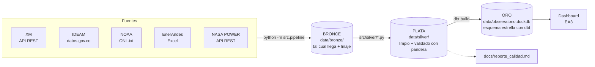
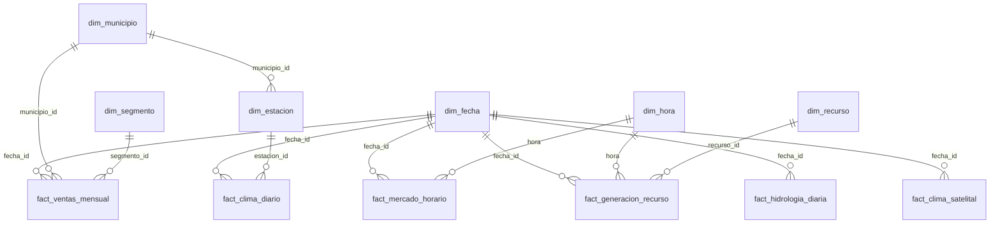
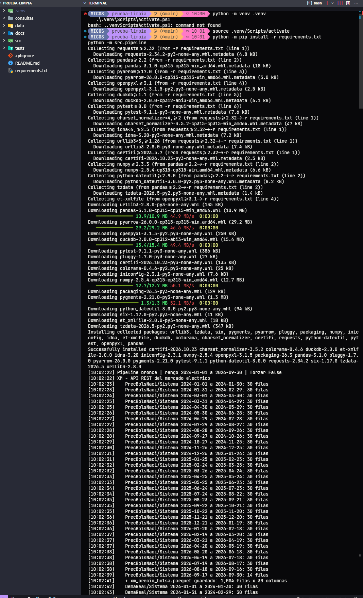
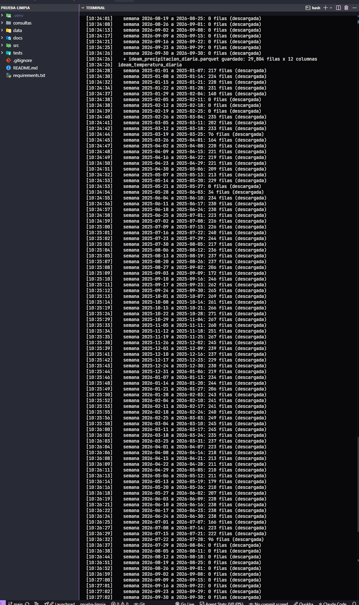
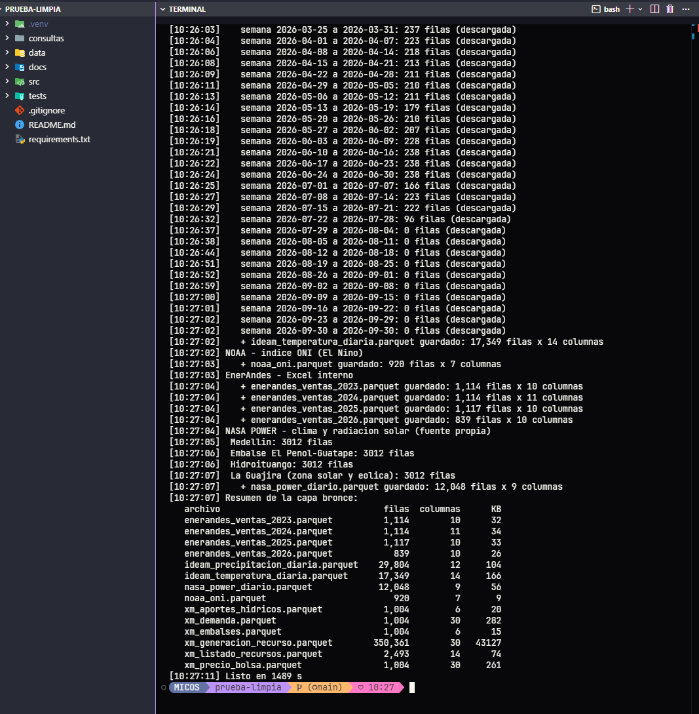
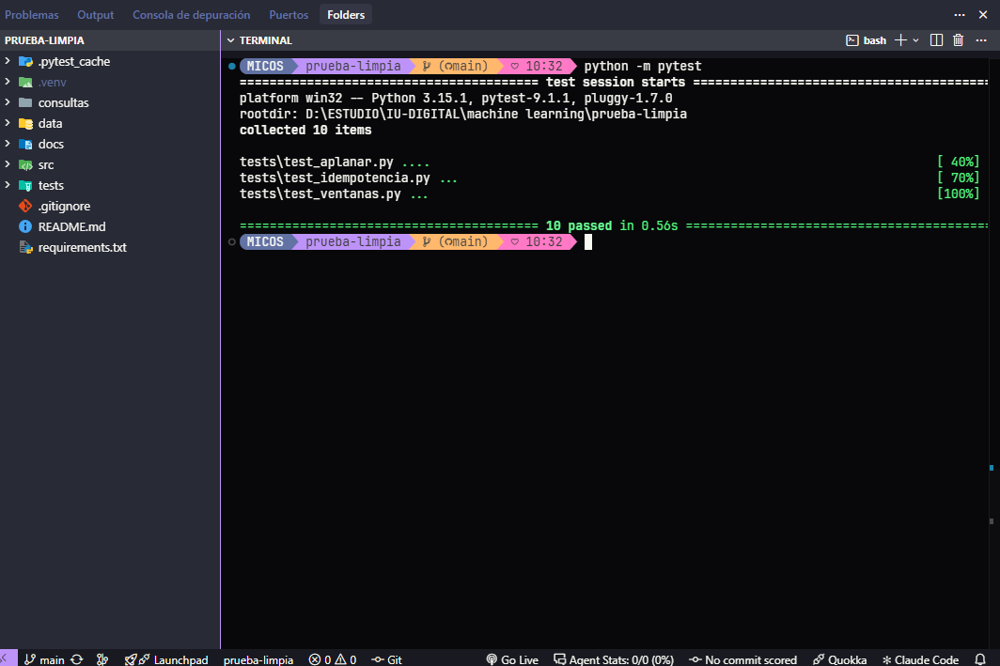

# Observatorio Energía y Clima – Grupo 1

> Proyecto Integrado IV – Integración de Información · IU Digital de Antioquia · 2026-2
>
> | Entrega | Qué construye | Tag |
> |---|---|---|
> | **EA1** – Extracción de datos de fuentes reales con Python | Capa **bronce**: 5 fuentes tal como llegan | `ea1` |
> | **EA2** – Calidad de datos y modelo dimensional | Capa **plata** (limpieza + pandera) y capa **oro** (esquema estrella con dbt) | `ea2` |

## 👥 Integrantes

| Nombre | Usuario GitHub | Rol | EA1 | EA2 |
|---|---|---|---|---|
| Aleicer Vesga Rueda | [@aleicer](https://github.com/aleicer) | Líder técnico / Data Engineer y Analytics Engineer | Extracción ampliada de XM e IDEAM, muestras, perfilamiento, README | Base de plata y oro, limpieza de EnerAndes (4 hojas), XM e IDEAM, comando `src.transformar`, modelo dbt completo, modelo dimensional, README |
| Jaider Morales | [@JaiderMoraless](https://github.com/JaiderMoraless) | Data Quality Analyst | Pruebas con pytest y hallazgos del perfilamiento | Limpieza de NOAA (ONI mensual y fase ENSO), 8 pruebas nuevas con pytest, diccionario de datos |
| Guillermo León Loaiza | [@memo-iud](https://github.com/memo-iud) | BI Analyst / Storyteller | Fuente propia NASA POWER | Limpieza de NASA POWER, consultas de negocio sobre la capa oro |

Como el equipo tiene 3 integrantes y el reto define 4 roles, Aleicer asume también el de Analytics Engineer.

## 🎯 Objetivo

Construir el **Observatorio de Energía y Clima** para la comercializadora EnerAndes: integrar datos del mercado eléctrico (XM), del clima (IDEAM y NASA POWER), del fenómeno de El Niño (NOAA) y de las ventas internas (Excel de EnerAndes), dejarlos **limpios y confiables** y organizarlos en un **esquema estrella** listo para el dashboard, para analizar el riesgo de precios altos y desabastecimiento ante El Niño 2026.

## 🏗️ Arquitectura



| Capa | Dónde | Qué tiene | Cómo se construye |
|---|---|---|---|
| **Bronce** | `data/bronze/*.parquet` | Los datos **tal como llegan**, con 3 columnas de linaje (`_fuente`, `_origen`, `_extraido_en`) | `python -m src.pipeline` (EA1) |
| **Plata** | `data/silver/*.parquet` | Los datos **limpios**: fechas como fecha, números como número, nombres unificados, una fila por hora en XM. Cada tabla se valida con **pandera** antes de guardarse; lo que no se puede corregir queda en **cuarentena** (`*_cuarentena.parquet`), no se borra | `src/silver/*.py` (una limpieza por fuente) |
| **Oro** | `data/observatorio.duckdb` | El **esquema estrella**: 6 tablas de hechos y 6 dimensiones, con 76 pruebas de dbt | `dbt build` (modelos en `dbt/models/`) |

Las capas plata y oro se construyen con **un solo comando**: `python -m src.transformar`.

## 📦 Fuentes de datos (capa bronce)

| # | Fuente | Tipo | Qué se extrae | Rango | Archivo(s) en `data/bronze/` | Filas |
|---|---|---|---|---|---|---:|
| 1 | **XM – API Sinergox** | API REST (POST, JSON), ventanas de 30 días | Precio de bolsa (hora) | 2024-01-01 a 2026-09-30 | `xm_precio_bolsa` | 1.004 |
| | | | Demanda real (hora) | 2024-01-01 a 2026-09-30 | `xm_demanda` | 1.004 |
| | | | Generación por planta, `Gene`/`Recurso` (hora) | 2024-01-01 a 2026-09-30 | `xm_generacion_recurso` | 350.345 |
| | | | % volumen útil de embalses (día) | 2024-01-01 a 2026-09-30 | `xm_embalses` | 1.004 |
| | | | Aportes hídricos, `AporEner` (día) | 2024-01-01 a 2026-09-30 | `xm_aportes_hidricos` | 1.004 |
| | | endpoint `lists`, sin fechas | Catálogo de plantas, `ListadoRecursos` | foto del día de descarga | `xm_listado_recursos` | 2.494 |
| 2 | **IDEAM – datos.gov.co** | API Socrata (SoQL), agregación en el servidor, semanas de 7 días | Precipitación diaria por estación (`sum`) | 2025-01-01 a 2026-09-30 * | `ideam_precipitacion_diaria` | 29.804 |
| | | | Temperatura media, mínima y máxima por estación (`avg`, `min`, `max`) | 2025-01-01 a 2026-09-30 * | `ideam_temperatura_diaria` | 17.349 |
| 3 | **NOAA – índice ONI** | Archivo de texto | Anomalía de temperatura del Pacífico (El Niño / La Niña) | 1950 – 2026 | `noaa_oni` | 920 |
| 4 | **EnerAndes** | Excel interno (una hoja por año) | Ventas mensuales por municipio, segmento y tipo de compra | 2023 – 2026 | `enerandes_ventas_2023` … `_2026` | 4.184 |
| 5 | **NASA POWER** (fuente propia) | API REST (GET, JSON) | Radiación solar, temperatura y lluvia diaria en 4 puntos | 2024-01-01 a 2026-09-30 | `nasa_power_diario` | 12.048 |

\* Se piden datos hasta el 30 de septiembre, pero el IDEAM solo ha publicado hasta el 24 de julio de 2026 (ver hallazgo H3 del perfilamiento).

**Sobre el IDEAM:** los datasets tienen millones de mediciones (una cada pocos minutos). El filtro (`$where`, solo Antioquia y la semana) y el resumen por estación y día (`$select` + `$group`) los hace el **servidor**, así que solo viajan los resúmenes. Como son 92 semanas por dataset, cada semana se guarda en una carpeta temporal: si la descarga se corta, al volver a ejecutar continúa donde iba.

### 🛰️ Fuente propia: NASA POWER

**Qué es:** servicio gratuito de la NASA con datos diarios de clima y energía solar, calculados con satélites y modelos, para cualquier punto del planeta.

**De dónde viene:** API REST <https://power.larc.nasa.gov/api/temporal/daily/point> (sin usuario ni clave). Script: `src/extract/nasa_power.py` → `data/bronze/nasa_power_diario.parquet`.

**Qué descargamos:** radiación solar (`ALLSKY_SFC_SW_DWN`), temperatura (`T2M`) y lluvia (`PRECTOTCORR`), del 1-ene-2024 al 30-sep-2026, en Medellín, el embalse Peñol-Guatapé, Hidroituango y La Guajira.

**Para qué la usaremos:** responder la **pregunta propia del equipo**: *durante El Niño 2026, ¿cuánto aumentó la radiación solar y cuánto compensó la generación solar la caída de la hidráulica?* Se cruza con XM (generación por planta + catálogo de plantas) y NOAA (ONI). Además cubre los meses recientes que el IDEAM todavía no publica.

## ⚙️ Cómo ejecutar (desde cero)

Requisitos: **Python 3.11 o superior** y Git. En Windows, con PowerShell:

```powershell
git clone https://github.com/aleicer/pi4-observatorio-energia-grupo-1.git
cd pi4-observatorio-energia-grupo-1
python -m venv .venv
.\.venv\Scripts\Activate.ps1          # en Git Bash: source .venv/Scripts/activate
python -m pip install -r requirements.txt   # incluye pandera, dbt-duckdb y pytest

python -m src.pipeline                # 1. BRONCE: descarga las 5 fuentes a data/bronze/
python -m src.transformar             # 2. PLATA y ORO: limpia, valida, escribe el reporte y corre dbt build
python -m pytest                      # 3. pruebas automáticas de las reglas
```

- **`python -m src.pipeline`** tarda entre 20 y 25 minutos la primera vez (el IDEAM es lento); las siguientes, segundos.
- **`python -m src.transformar`** tarda menos de un minuto:
  1. ejecuta cada limpieza de `src/silver/` (las encuentra solo: `enerandes`, `ideam`, `nasa_power`, `noaa`, `xm`);
  2. valida cada tabla con su esquema de pandera (`src/quality/`) antes de guardarla en `data/silver/`;
  3. escribe `docs/reporte_calidad.md` con la métrica antes y después de cada regla;
  4. ejecuta `dbt build`: crea el esquema estrella en `data/observatorio.duckdb` y corre sus 76 pruebas. Debe terminar en `PASS=76 ERROR=0`.
- Solo la capa plata: `python -m src.transformar --solo-plata`. Una sola fuente: `python -m src.silver.xm`.
- Solo la capa oro: `dbt build --project-dir dbt --profiles-dir dbt`.
- Una consulta rápida sobre oro: `dbt show --project-dir dbt --profiles-dir dbt --inline "select * from {{ ref('dim_fecha') }} limit 5"`.
- Las fechas, URLs y métricas se cambian en un solo lugar: `src/config.py`.
- **No se suben a GitHub** `data/bronze/`, `data/silver/`, `data/observatorio.duckdb`, `dbt/target/` ni `dbt/logs/` (están en `.gitignore`): se regeneran con los comandos de arriba.

Comandos adicionales:

| Comando | Qué hace |
|---|---|
| `python -m src.muestras` | Regenera `data/sample/` con las primeras 200 filas de cada archivo de bronce, en CSV |
| `python -m src.perfilamiento` | Regenera las tablas de `docs/perfilamiento.md` (conserva los hallazgos escritos a mano) |
| `python -m src.silver.reporte` | Regenera solo `docs/reporte_calidad.md` a partir de las métricas guardadas |
| `python -m src.consultar` | Ejecuta las consultas SQL de `consultas/` con DuckDB, directo sobre los Parquet |

> Si PowerShell no deja activar el entorno: `Set-ExecutionPolicy -Scope CurrentUser RemoteSigned`.

## 🥈 Capa plata: calidad de datos

Cada fuente tiene su limpieza en `src/silver/` con dos funciones: `limpiar()` aplica las reglas una por una y **mide cada
problema antes y después** (sin leer ni guardar archivos, para poder probarla con pytest), y `main()` lee bronce, limpia y
llama a `guardar_plata()`, que **valida con pandera** y solo guarda si todo cumple.

**Resumen del [reporte de calidad](docs/reporte_calidad.md)** (generado por el código):

| Fuente | Tabla de plata | Filas en bronce | Filas en plata | Filas en cuarentena | Reglas |
|---|---|---:|---:|---:|---:|
| EnerAndes | `enerandes_ventas` | 4.184 | 4.007 | 43 | 19 |
| IDEAM | `ideam_precipitacion_diaria` | 29.804 | 29.691 | 113 | 6 |
| IDEAM | `ideam_temperatura_diaria` | 17.349 | 16.720 | 629 | 8 |
| IDEAM | `ideam_estaciones` | 47.153 | 73 | 0 | 3 |
| NASA POWER | `nasa_power_diario` | 12.048 | 4.016 | 0 | 4 |
| NOAA | `noaa_oni_mensual` | 920 | 920 | 0 | 5 |
| XM | `xm_mercado_horario` | 2.008 | 24.096 | 0 | 6 |
| XM | `xm_generacion_recurso` | 350.345 | 5.935.362 | 0 | 4 |
| XM | `xm_hidrologia_diaria` | 2.008 | 1.004 | 0 | 4 |
| XM | `xm_recursos` | 2.493 | 2.501 | 0 | 4 |

**Total: 63 reglas de calidad y 785 filas en cuarentena.** Algunas reglas con su métrica antes → después:

| Fuente | Problema | Regla aplicada | Antes → Después |
|---|---|---|---|
| EnerAndes | Encabezados distintos en cada hoja | Traducir cada encabezado a 8 nombres estándar | 4 → 1 |
| EnerAndes | Fechas en 4 formatos (`2024-03`, `mar-24`, `03/2024`, `01/03/2026`) | Leer cada formato y dejar `AAAA-MM` (`01/03/2026` es día/mes/año: marzo) | 4 → 1 |
| EnerAndes | Energía en MWh mezclada con kWh (hoja 2024) | Multiplicar por 1.000 | 337 → 0 |
| EnerAndes | Municipio escrito de varias formas | Unificar con el código DIVIPOLA | 32 → 15 |
| EnerAndes | Filas duplicadas | Dejar una sola copia | 120 → 0 |
| EnerAndes | Energía vacía / negativa | Pasar a cuarentena | 25 → 0 / 18 → 0 |
| XM | Filas en formato ancho (24 columnas por hora) | Pasar a una fila por fecha y hora | 2.008 → 0 |
| XM | Plantas que generan pero no están en el catálogo | Agregarlas con tipo `DESCONOCIDO` | 10 → 0 |
| IDEAM | Temperatura mínima de 0 °C (sensor en cero) | Pasar a cuarentena | 605 → 0 |
| IDEAM | Más observaciones que minutos del día | Pasar a cuarentena | 111 → 0 |
| NOAA | Trimestres móviles sin mes asignado | Asignar el mes central (DJF → enero) y la fase ENSO | 920 → 0 |
| NASA POWER | Valor −999 (sin dato) tratado como número | Cambiarlo por vacío | 4 → 0 |

**Cuarentena:** las 785 filas que no se pudieron corregir están en `data/silver/*_cuarentena.parquet` con la columna
`motivo_cuarentena` (energía vacía o negativa en EnerAndes; lluvia imposible, sensores en cero o datos repetidos en el IDEAM).
El detalle por fuente está al final de cada tabla del reporte.

**Validación con pandera:** cada tabla de plata tiene su esquema en `src/quality/` (`esquemas.py`, `esquemas_xm.py`,
`esquemas_ideam.py`) con reglas de **tipo**, **rangos** (por ejemplo, volumen útil entre 0 y 100 %, temperatura entre 2 y 42 °C),
**valores aceptados** (Bolsa / Contrato, El Niño / La Niña / Neutral) y **llaves únicas** (una venta por mes, municipio,
segmento y tipo; una fila por fecha y hora en XM).

### Perfilamiento de la capa bronce (EA1)

[`docs/perfilamiento.md`](docs/perfilamiento.md) tiene una tabla por cada archivo de bronce con filas, columnas, tipos de datos, % de nulos por columna, filas duplicadas y rango de fechas, y al final **6 hallazgos de calidad** con su evidencia numérica. Algunos ejemplos:

- El IDEAM publica con rezago: los datos llegan solo hasta el 24 de julio de 2026 (68 días menos de lo pedido).
- Cada hoja de EnerAndes trae filas duplicadas (32 por año en 2023 a 2025 y 24 en 2026).
- En la generación por planta de XM, cerca del 52 % de las horas nocturnas vienen vacías, frente a menos del 7 % al mediodía.

## 🥇 Capa oro: modelo dimensional

Esquema estrella construido con **dbt** sobre **DuckDB**: 6 tablas de hechos que comparten 6 dimensiones. El diagrama
completo con todas las columnas, el grano de cada hecho y las dimensiones están en
[`docs/modelo_dimensional.md`](docs/modelo_dimensional.md), y cada columna está explicada en
[`docs/diccionario_datos.md`](docs/diccionario_datos.md).



| Hecho | Grano (una fila es…) | Filas |
|---|---|---:|
| `fact_ventas_mensual` | un mes, un municipio, un segmento y un tipo de compra | 4.007 |
| `fact_mercado_horario` | una fecha y una hora (precio de bolsa y demanda) | 24.096 |
| `fact_generacion_recurso` | una fecha, una hora y una planta | 5.935.362 |
| `fact_hidrologia_diaria` | una fecha (volumen útil y aportes) | 1.004 |
| `fact_clima_diario` | una fecha y una estación del IDEAM | 30.200 |
| `fact_clima_satelital` | una fecha y un punto de NASA POWER | 4.016 |

Dimensiones: `dim_fecha` (un día, con mes, trimestre, día de la semana y **fase ENSO**), `dim_hora` (franja Pico / Media /
Valle), `dim_municipio` (DIVIPOLA), `dim_segmento`, `dim_recurso` (plantas, desde `ListadoRecursos`) y `dim_estacion`.

**Pruebas de dbt (76):** `unique` y `not_null` en las llaves de las dimensiones, `relationships` en todas las llaves de los
hechos, `accepted_values` en las categorías y 4 pruebas propias del **grano** en `dbt/tests/`.

## 📊 Resultados de las consultas (capa oro)

Las consultas se ejecutan con `python -m src.consultar_oro`. El resultado completo también está disponible en [`docs/resultados_consultas.md`](docs/resultados_consultas.md).

### 1. ¿Cómo cambia el precio de bolsa según la fase de El Niño?

| Año | Fase ENSO | Días | Precio promedio COP/kWh | Precio máximo COP/kWh |
|---:|---|---:|---:|---:|
| 2024 | El Niño | 121 | 624.6 | 1267.6 |
| 2024 | Neutral | 245 | 701.5 | 2675.6 |
| 2025 | La Niña | 92 | 222.8 | 1079.2 |
| 2025 | Neutral | 273 | 246.1 | 2224.0 |
| 2026 | El Niño | 153 | 693.4 | 1846.7 |
| 2026 | Neutral | 120 | 208.0 | 1175.4 |

En 2026, el precio promedio durante El Niño fue de 693,4 COP/kWh, frente a 208,0 COP/kWh en la fase Neutral. Sin embargo, en 2024 el promedio Neutral fue mayor que el de El Niño, por lo que la fase ENSO influye, pero no explica por sí sola el comportamiento del precio.

### 2. ¿Qué proporción de la energía viene de cada tipo de planta, por año?

| Año | Tipo | Generación TWh | Porcentaje |
|---:|---|---:|---:|
| 2024 | HIDRAULICA | 54.49 | 65.4 |
| 2024 | TERMICA | 24.44 | 29.4 |
| 2024 | SOLAR | 3.30 | 4.0 |
| 2024 | COGENERADOR | 0.84 | 1.0 |
| 2024 | EOLICA | 0.15 | 0.2 |
| 2024 | DESCONOCIDO | 0.05 | 0.1 |
| 2025 | HIDRAULICA | 68.10 | 80.7 |
| 2025 | TERMICA | 10.81 | 12.8 |
| 2025 | SOLAR | 4.47 | 5.3 |
| 2025 | COGENERADOR | 0.85 | 1.0 |
| 2025 | EOLICA | 0.15 | 0.2 |
| 2025 | DESCONOCIDO | 0.02 | 0.0 |
| 2026 | HIDRAULICA | 47.53 | 71.5 |
| 2026 | TERMICA | 12.94 | 19.5 |
| 2026 | SOLAR | 5.23 | 7.9 |
| 2026 | COGENERADOR | 0.65 | 1.0 |
| 2026 | EOLICA | 0.16 | 0.2 |
| 2026 | DESCONOCIDO | 0.00 | 0.0 |

La generación hidráulica fue la principal fuente en los tres años. La participación solar aumentó del 4,0 % en 2024 al 7,9 % en 2026. Los valores absolutos de 2026 deben interpretarse considerando que los datos llegan hasta septiembre.

### 3. ¿Cuánto le habría costado a EnerAndes comprar en bolsa la energía de cada año?

| Año | Energía GWh | Costo en bolsa, mil millones COP |
|---:|---:|---:|
| 2024 | 736.6 | 493.2 |
| 2025 | 770.6 | 183.6 |
| 2026 | 595.3 | 287.8 |

Aunque 2025 tuvo la mayor cantidad de energía, presentó el menor costo hipotético debido a los menores precios de bolsa. El costo más alto se obtuvo en 2024, con 493,2 mil millones de pesos.

### 4. ¿Sube la radiación y la generación solar durante El Niño?

| Fase ENSO | Radiación promedio kWh/m² | Generación solar GWh/mes |
|---|---:|---:|
| El Niño | 6.05 | 450.7 |
| Neutral | 5.67 | 365.8 |
| La Niña | 4.93 | 420.4 |

El Niño presentó la mayor radiación promedio y la mayor generación solar mensual. No obstante, La Niña tuvo más generación solar que la fase Neutral, por lo que la relación no es completamente lineal y también intervienen factores como la capacidad instalada y la disponibilidad de las plantas.

## 📂 Estructura del repositorio

```
├── src/
│   ├── config.py           # fechas, URLs, métricas y rutas (todo lo configurable)
│   ├── utils.py            # log, HTTP con reintentos, ventanas, idempotencia, guardar en bronce
│   ├── pipeline.py         # BRONCE: python -m src.pipeline
│   ├── extract/            # un extractor por fuente: xm, ideam, noaa, enerandes, nasa_power
│   ├── transformar.py      # PLATA + ORO: python -m src.transformar
│   ├── silver/             # una limpieza por fuente + comun.py (medir, cuarentena, guardar) + reporte.py
│   ├── quality/            # esquemas de pandera de cada tabla de plata
│   ├── muestras.py         # genera data/sample/
│   ├── perfilamiento.py    # genera docs/perfilamiento.md
│   └── consultar.py        # consultas SQL con DuckDB
├── dbt/
│   ├── dbt_project.yml     # proyecto dbt (rango de fechas en vars)
│   ├── profiles.yml        # conexión: data/observatorio.duckdb
│   ├── models/staging/     # lee cada tabla de la capa plata
│   ├── models/marts/       # dimensiones, hechos y schema.yml (grano, descripciones y pruebas)
│   └── tests/              # pruebas del grano de los hechos
├── tests/                  # pruebas con pytest (bronce y plata)
├── data/
│   ├── insumos/            # Excel interno de EnerAndes
│   ├── bronze/ silver/     # capas bronce y plata (NO se suben a GitHub)
│   └── sample/             # 200 filas de cada archivo de bronce, en CSV
├── consultas/              # SQL de ejemplo (EA1) y consultas/oro/ (EA2)
└── docs/
    ├── perfilamiento.md        # perfil de bronce + hallazgos (EA1)
    ├── reporte_calidad.md      # reglas de plata con su antes y después (EA2, generado)
    ├── modelo_dimensional.md   # diagrama y grano del esquema estrella (EA2)
    ├── diccionario_datos.md    # columnas de cada tabla de oro (EA2)
    └── bitacoras/              # una bitácora por integrante
```

## 🧪 Pruebas automáticas

`python -m pytest` ejecuta **25 pruebas** con datos de ejemplo pequeños escritos en cada prueba:

| Archivo | Qué comprueba | Entrega |
|---|---|---|
| `test_ventanas.py` | Que `ventanas()` parta bien un rango de fechas (incluido el año bisiesto), sin huecos ni días repetidos | EA1 |
| `test_aplanar.py` | Que `aplanar()` convierta bien el JSON de XM por hora, por día y de listas | EA1 |
| `test_idempotencia.py` | Que `ya_existe()` omita los archivos que ya están y los descargue de nuevo con `--forzar` | EA1 |
| `test_limpieza.py` | Las reglas de la clase: tildes, alias de municipios, totales, duplicados, cuarentena y pandera | EA2 (clase) |
| `test_noaa.py` | Umbrales de la fase ENSO, trimestre móvil → mes central y que pandera rechace una fase inventada | EA2 |
| `test_nasa_power.py` | Que el −999 de NASA quede vacío y que pase a una fila por punto y día | EA2 |
| `test_reglas_plata.py` | Fechas en 4 formatos (`mar-24`, `03/2024`, `01/03/2026` = marzo), MWh a kWh y XM de 24 columnas a una fila por hora | EA2 |

Además, `dbt build` corre **76 pruebas** sobre la capa oro (ver arriba).

### 📸 Capturas de la consola (EA1: capa bronce)

Pipeline completo desde un clon nuevo (la salida es larga, por eso va en tres partes):

**1. Inicio y XM** (6 métricas en ventanas de 30 días)



**2. IDEAM** (precipitación y temperatura por semanas; las "0 filas" del final son el rezago de publicación)



**3. NOAA, EnerAndes, NASA POWER y resumen de la capa bronce**



Pruebas automáticas:



## 🤝 Trabajo colaborativo

- La rama `main` está protegida: todo cambio entra por Pull Request aprobado por otro integrante.
- Una rama por tarea (`feature/plata-enerandes`, `feature/plata-noaa`, `test/reglas-plata`, `feature/oro-estrella`…) y commits con prefijos `feat:`, `fix:`, `test:`, `docs:`.
- Tareas en el tablero de GitHub Projects, como issues asignados a cada integrante.
- Bitácoras individuales en [`docs/bitacoras/`](docs/bitacoras/).

## 🎥 Videos de sustentación

### EA2 – Calidad de datos y modelo dimensional (capas plata y oro)

| Integrante | Video |
|---|---|
| Aleicer Vesga Rueda | _(pendiente)_ |
| Jaider Morales | _(pendiente)_ |
| Guillermo León Loaiza | _(pendiente)_ |

### EA1 – Extracción (capa bronce)

| Integrante | Video |
|---|---|
| Aleicer Vesga Rueda | [Ver video](https://drive.google.com/file/d/163Wuja0SsmBLQEGa1KERaVIvo3C-EkqF/view?usp=drivesdk) |
| Jaider Morales | [Ver video](https://drive.google.com/file/d/1ZDGnIt2TOh8p0XkoftEHaWsDAKZ9k53b/view?usp=sharing) |
| Guillermo León Loaiza | [Ver video](https://drive.google.com/file/d/1T8Tba5aNBp9DUU-63DiCZsT3N2LP0xPE/view?usp=sharing) |

## 🤖 Uso de IA

El equipo usó **Claude (Anthropic)** como asistente durante la EA1 y la EA2, para:

- Planear cada entrega, repartir las tareas del equipo y preparar guías de trabajo para cada integrante.
- Proponer y revisar código: los extractores (EA1); las limpiezas de la capa plata, los esquemas de pandera, el comando `src.transformar` y el modelo dbt (EA2); y ejemplos de pruebas con pytest.
- Revisar el estado de las ramas y los Pull Requests, y explicar errores durante la ejecución.

Todo el código se ejecutó y revisó por el equipo antes de cada Pull Request. Los datos, las métricas de calidad y los resultados salen de la ejecución real del pipeline, y cada integrante explica en su video la parte que construyó.
