# Observatorio Energía y Clima – Grupo 1

[](https://github.com/aleicer/pi4-observatorio-energia-grupo-1/actions/workflows/pipeline.yml)

> Proyecto Integrado IV – Integración de Información · IU Digital de Antioquia · 2026-2
>
> | Entrega | Qué construye | Tag |
> |---|---|---|
> | **EA1** – Extracción de datos de fuentes reales con Python | Capa **bronce**: 5 fuentes tal como llegan | `ea1` |
> | **EA2** – Calidad de datos y modelo dimensional | Capa **plata** (limpieza + pandera) y capa **oro** (esquema estrella con dbt) | `ea2` |
> | **EA3** – Entrega final | Pipeline automático en **GitHub Actions**, **dashboard** e **informe de hallazgos** | `final` |

**📊 [Dashboard publicado](https://iud-observatorio-energia-grupo-1.streamlit.app/) · 📄 [Informe de hallazgos (PDF)](docs/informe_final.pdf) · ⚙️ [Ejecuciones del pipeline](https://github.com/aleicer/pi4-observatorio-energia-grupo-1/actions/workflows/pipeline.yml) · ✅ [Reporte de calidad](docs/reporte_calidad.md)**

## 👥 Integrantes

Los roles rotaron al iniciar la EA3 (9 de noviembre): cada integrante asumió un rol distinto al de las EA1 y EA2.

| Nombre | Usuario GitHub | Rol (S1–S4: EA1 y EA2) | Rol (S5–S7: EA3) |
|---|---|---|---|
| Aleicer Vesga Rueda | [@aleicer](https://github.com/aleicer) | Líder técnico / Data Engineer y Analytics Engineer | BI Analyst / Storyteller y Data Quality Analyst (pruebas de los KPIs) |
| Jaider Morales | [@JaiderMoraless](https://github.com/JaiderMoraless) | Data Quality Analyst | Data Engineer |
| Guillermo León Loaiza | [@memo-iud](https://github.com/memo-iud) | BI Analyst / Storyteller | Analytics Engineer |

Como el equipo tiene 3 integrantes y el reto define 4 roles, en cada etapa un integrante asumió dos: Aleicer el de Analytics Engineer en las EA1 y EA2, y el de Data Quality Analyst en la EA3.

**Qué construyó cada uno**

| Nombre | EA1 | EA2 | EA3 |
|---|---|---|---|
| Aleicer | Extracción ampliada de XM e IDEAM, muestras, perfilamiento, README | Base de plata y oro, limpieza de EnerAndes (4 hojas), XM e IDEAM, comando `src.transformar`, modelo dbt completo, modelo dimensional, README | Dashboard en Streamlit, pruebas de los KPIs, informe de hallazgos, README final |
| Jaider | Pruebas con pytest y hallazgos del perfilamiento | Limpieza de NOAA (ONI mensual y fase ENSO), 8 pruebas nuevas con pytest, diccionario de datos | Workflow de GitHub Actions, exportación de la capa oro, historia de XM desde 2015 y precio de contratos |
| Guillermo | Fuente propia NASA POWER | Limpieza de NASA POWER, consultas de negocio sobre la capa oro | Modelos de dbt para el dashboard (precio de contratos y 4 tablas resumidas) |

## 🎯 Objetivo

Construir el **Observatorio de Energía y Clima** para la comercializadora EnerAndes: integrar datos del mercado eléctrico (XM), del clima (IDEAM y NASA POWER), del fenómeno de El Niño (NOAA) y de las ventas internas (Excel de EnerAndes), dejarlos **limpios y confiables** y organizarlos en un **esquema estrella** listo para el dashboard, para analizar el riesgo de precios altos y desabastecimiento ante El Niño 2026.

## ❓ Preguntas de negocio que responde el dashboard

Las 6 preguntas de la sección 3 del reto, con la tabla de la capa oro que responde cada una:

| # | Pregunta | Tabla de la capa oro |
|---|---|---|
| 1 | **Riesgo hídrico:** ¿cómo ha evolucionado el volumen útil de los embalses y en qué se parece la situación actual a El Niño 2015-2016 y 2023-2024? | `mart_hidroclima_mensual` |
| 2 | **Clima → precio:** ¿qué relación hay entre el ONI, la lluvia en las cuencas y el precio de bolsa? ¿Con cuántos meses de rezago se nota el efecto? | `mart_hidroclima_mensual` |
| 3 | **Matriz de generación:** ¿qué proporción viene de fuente hidráulica, térmica, solar y eólica, y cómo cambia en épocas secas? | `mart_generacion_tipo_diaria` |
| 4 | **Demanda:** ¿cuáles son los patrones de demanda por hora, día de la semana y mes? ¿Cuál es la hora pico? | `mart_mercado_horario` |
| 5 | **Impacto en el negocio:** ¿cuánto le habría costado a EnerAndes comprar en bolsa en lugar de por contrato en cada mes? ¿Qué municipios o segmentos concentran el riesgo? | `mart_ventas_costo_mensual` |
| 6 | **Pregunta propia:** durante El Niño, ¿cuánto aumentó la radiación solar y cuánto compensó la generación solar la caída de la hidráulica? (XM + NASA POWER + NOAA) | `mart_generacion_tipo_diaria` y `mart_hidroclima_mensual` |

## 🏗️ Arquitectura

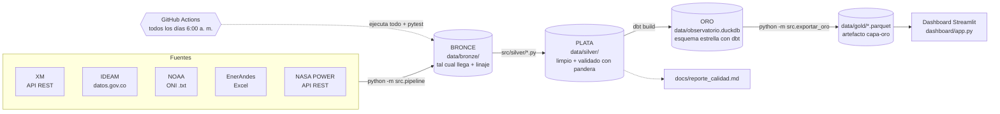

| Capa | Dónde | Qué tiene | Cómo se construye |
|---|---|---|---|
| **Bronce** | `data/bronze/*.parquet` | Los datos **tal como llegan**, con 3 columnas de linaje (`_fuente`, `_origen`, `_extraido_en`) | `python -m src.pipeline` (EA1) |
| **Plata** | `data/silver/*.parquet` | Los datos **limpios**: fechas como fecha, números como número, nombres unificados, una fila por hora en XM. Cada tabla se valida con **pandera** antes de guardarse; lo que no se puede corregir queda en **cuarentena** (`*_cuarentena.parquet`), no se borra | `src/silver/*.py` (una limpieza por fuente) |
| **Oro** | `data/observatorio.duckdb` | El **esquema estrella**: 7 tablas de hechos y 6 dimensiones, más **4 tablas resumidas para el dashboard** (`dbt/models/dashboard/`), con 79 pruebas de dbt | `dbt build` (modelos en `dbt/models/`) |
| **Exportación** | `data/gold/*.parquet` | Las 17 tablas de oro en Parquet, que lee el dashboard | `python -m src.exportar_oro` (EA3) |

Las capas plata y oro se construyen con **un solo comando**: `python -m src.transformar`. En GitHub, el workflow
[`.github/workflows/pipeline.yml`](.github/workflows/pipeline.yml) ejecuta **todo el pipeline solo, todos los días** (ver
*Automatización con GitHub Actions* en [Cómo ejecutar](#️-cómo-ejecutar-desde-cero)).

## 📦 Fuentes de datos (capa bronce)

| # | Fuente | Tipo | Qué se extrae | Rango | Archivo(s) en `data/bronze/` | Filas |
|---|---|---|---|---|---|---:|
| 1 | **XM – API Sinergox** | API REST (POST, JSON), ventanas de 30 días | Precio de bolsa (hora) | **2015-01-01** a 2026-09-30 | `xm_precio_bolsa` | 4.291 |
| | | | Demanda real (hora) | **2015-01-01** a 2026-09-30 | `xm_demanda` | 4.291 |
| | | | Generación por planta, `Gene`/`Recurso` (hora) | 2024-01-01 a 2026-09-30 | `xm_generacion_recurso` | 350.345 |
| | | | % volumen útil de embalses (día) | **2015-01-01** a 2026-09-30 | `xm_embalses` | 4.291 |
| | | | Aportes hídricos, `AporEner` (día) | **2015-01-01** a 2026-09-30 | `xm_aportes_hidricos` | 4.291 |
| | | | Precio promedio de contratos, `PrecPromCont` (día) — EA3 | **2015-01-01** a 2026-09-30 | `xm_precio_contratos` | 4.291 |
| | | endpoint `lists`, sin fechas | Catálogo de plantas, `ListadoRecursos` | foto del día de descarga | `xm_listado_recursos` | 2.494 |
| 2 | **IDEAM – datos.gov.co** | API Socrata (SoQL), agregación en el servidor, semanas de 7 días | Precipitación diaria por estación (`sum`) | 2025-01-01 a 2026-09-30 * | `ideam_precipitacion_diaria` | 29.804 |
| | | | Temperatura media, mínima y máxima por estación (`avg`, `min`, `max`) | 2025-01-01 a 2026-09-30 * | `ideam_temperatura_diaria` | 17.349 |
| 3 | **NOAA – índice ONI** | Archivo de texto | Anomalía de temperatura del Pacífico (El Niño / La Niña) | 1950 – 2026 | `noaa_oni` | 920 |
| 4 | **EnerAndes** | Excel interno (una hoja por año) | Ventas mensuales por municipio, segmento y tipo de compra | 2023 – 2026 | `enerandes_ventas_2023` … `_2026` | 4.184 |
| 5 | **NASA POWER** (fuente propia) | API REST (GET, JSON) | Radiación solar, temperatura y lluvia diaria en 4 puntos | 2024-01-01 a 2026-09-30 | `nasa_power_diario` | 12.048 |

**EA3:** las métricas de XM del **sistema** se traen desde 2015 para comparar con El Niño 2015-2016 y medir el rezago
entre el ONI y el precio con 11 años de datos (`XM_HISTORIA_INICIO` en `src/config.py`). La generación por planta sigue
desde 2024 porque son millones de filas.

\* Se piden datos hasta el 30 de septiembre, pero el IDEAM solo ha publicado hasta el 24 de julio de 2026 (ver hallazgo H3 del perfilamiento).

**Sobre el IDEAM:** los datasets tienen millones de mediciones (una cada pocos minutos). El filtro (`$where`, solo Antioquia y la semana) y el resumen por estación y día (`$select` + `$group`) los hace el **servidor**, así que solo viajan los resúmenes. Como son 92 semanas por dataset, cada semana se guarda en una carpeta temporal: si la descarga se corta, al volver a ejecutar continúa donde iba.

### 🛰️ Fuente propia: NASA POWER

**Qué es:** servicio gratuito de la NASA con datos diarios de clima y energía solar, calculados con satélites y modelos, para cualquier punto del planeta.

**De dónde viene:** API REST <https://power.larc.nasa.gov/api/temporal/daily/point> (sin usuario ni clave). Script: `src/extract/nasa_power.py` → `data/bronze/nasa_power_diario.parquet`.

**Qué descargamos:** radiación solar (`ALLSKY_SFC_SW_DWN`), temperatura (`T2M`) y lluvia (`PRECTOTCORR`), del 1-ene-2024 al 30-sep-2026, en Medellín, el embalse Peñol-Guatapé, Hidroituango y La Guajira.

**Para qué la usaremos:** responder la **pregunta propia del equipo**: *durante El Niño 2026, ¿cuánto aumentó la radiación solar y cuánto compensó la generación solar la caída de la hidráulica?* Se cruza con XM (generación por planta + catálogo de plantas) y NOAA (ONI). Además cubre los meses recientes que el IDEAM todavía no publica.

## ⚙️ Cómo ejecutar (desde cero)

Requisitos: **Python 3.11 o superior** y Git. En Windows, con PowerShell:

```powershell
git clone https://github.com/aleicer/pi4-observatorio-energia-grupo-1.git
cd pi4-observatorio-energia-grupo-1
python -m venv .venv
.\.venv\Scripts\Activate.ps1          # en Git Bash: source .venv/Scripts/activate
python -m pip install -r requirements.txt   # incluye pandera, dbt-duckdb y pytest

python -m src.pipeline                # 1. BRONCE: descarga las 5 fuentes a data/bronze/
python -m src.transformar             # 2. PLATA y ORO: limpia, valida, escribe el reporte y corre dbt build
python -m pytest                      # 3. pruebas automáticas de las reglas
```

- **`python -m src.pipeline`** tarda entre 20 y 25 minutos la primera vez (el IDEAM es lento); las siguientes, segundos.
- **`python -m src.transformar`** tarda menos de un minuto:
  1. ejecuta cada limpieza de `src/silver/` (las encuentra solo: `enerandes`, `ideam`, `nasa_power`, `noaa`, `xm`);
  2. valida cada tabla con su esquema de pandera (`src/quality/`) antes de guardarla en `data/silver/`;
  3. escribe `docs/reporte_calidad.md` con la métrica antes y después de cada regla;
  4. ejecuta `dbt build`: crea el esquema estrella en `data/observatorio.duckdb` y corre sus 79 pruebas (más 28 modelos). Debe terminar en `PASS=107 ERROR=0`.
- Solo la capa plata: `python -m src.transformar --solo-plata`. Una sola fuente: `python -m src.silver.xm`.
- Solo la capa oro: `dbt build --project-dir dbt --profiles-dir dbt`.
- Una consulta rápida sobre oro: `dbt show --project-dir dbt --profiles-dir dbt --inline "select * from {{ ref('dim_fecha') }} limit 5"`.
- Las fechas, URLs y métricas se cambian en un solo lugar: `src/config.py`.
- **No se suben a GitHub** `data/bronze/`, `data/silver/`, `data/observatorio.duckdb`, `dbt/target/` ni `dbt/logs/` (están en `.gitignore`): se regeneran con los comandos de arriba.

Comandos adicionales:

| Comando | Qué hace |
|---|---|
| `python -m src.muestras` | Regenera `data/sample/` con las primeras 200 filas de cada archivo de bronce, en CSV |
| `python -m src.perfilamiento` | Regenera las tablas de `docs/perfilamiento.md` (conserva los hallazgos escritos a mano) |
| `python -m src.silver.reporte` | Regenera solo `docs/reporte_calidad.md` a partir de las métricas guardadas |
| `python -m src.consultar` | Ejecuta las consultas SQL de `consultas/` con DuckDB, directo sobre los Parquet |

> Si PowerShell no deja activar el entorno: `Set-ExecutionPolicy -Scope CurrentUser RemoteSigned`.

**Dashboard (EA3):**

```powershell
python -m src.exportar_oro                    # copia las 17 tablas de oro a data/gold/*.parquet
python -m pip install -r dashboard/requirements.txt
streamlit run dashboard/app.py                # se abre en http://localhost:8501
```

Sin ejecutar el pipeline también se puede ver: descarga el artefacto **`capa-oro`** de la última ejecución en verde de
[Actions](https://github.com/aleicer/pi4-observatorio-energia-grupo-1/actions) y descomprímelo en `data/gold/`. Si no hay
`data/gold/`, el dashboard lee la copia de `dashboard/datos/` (la que usa la versión publicada; se actualiza con
`python dashboard/actualizar_datos.py`).

### Automatización con GitHub Actions

El workflow [`.github/workflows/pipeline.yml`](.github/workflows/pipeline.yml) ejecuta el pipeline completo en una máquina
de GitHub:

| Cuándo | Cómo |
|---|---|
| Todos los días a las 6:00 a. m. (Colombia) | `schedule` con `cron: "0 11 * * *"` |
| A mano | Botón **Run workflow** (`workflow_dispatch`), con la casilla *forzar* para volver a descargar todo |
| En cada Pull Request hacia `main` | `pull_request`: quien revisa ve si todo pasa antes de aprobar |

Pasos: instalar Python 3.11 y las librerías → restaurar la capa bronce de la **caché** (solo descarga lo que falta; el
IDEAM tarda 25 minutos desde cero) → **bronce** (`python -m src.pipeline`) → **plata** (`python -m src.transformar --solo-plata`)
→ **oro** (`dbt build`) → **pruebas** (`python -m pytest`) → **exportar** (`python -m src.exportar_oro`) → publicar los
artefactos **`capa-oro`** (17 Parquet) y **`reporte-calidad`**. La tabla con las filas de cada tabla queda en el resumen de
cada ejecución. Ninguna fuente necesita clave; si alguna la necesitara, iría en *GitHub Secrets* y en un `.env` (que está en
`.gitignore`).

Las capturas de las ejecuciones en verde están en [Evidencias de la EA3](#-evidencias-de-la-ea3).

## 🥈 Capa plata: calidad de datos

Cada fuente tiene su limpieza en `src/silver/` con dos funciones: `limpiar()` aplica las reglas una por una y **mide cada
problema antes y después** (sin leer ni guardar archivos, para poder probarla con pytest), y `main()` lee bronce, limpia y
llama a `guardar_plata()`, que **valida con pandera** y solo guarda si todo cumple.

**Resumen del [reporte de calidad](docs/reporte_calidad.md)** (generado por el código):

| Fuente | Tabla de plata | Filas en bronce | Filas en plata | Filas en cuarentena | Reglas |
|---|---|---:|---:|---:|---:|
| EnerAndes | `enerandes_ventas` | 4.184 | 4.007 | 43 | 19 |
| IDEAM | `ideam_precipitacion_diaria` | 29.804 | 29.691 | 113 | 6 |
| IDEAM | `ideam_temperatura_diaria` | 17.349 | 16.720 | 629 | 8 |
| IDEAM | `ideam_estaciones` | 47.153 | 73 | 0 | 3 |
| NASA POWER | `nasa_power_diario` | 12.048 | 4.016 | 0 | 4 |
| NOAA | `noaa_oni_mensual` | 921 | 921 | 0 | 5 |
| XM | `xm_mercado_horario` | 8.582 | 102.984 | 0 | 6 |
| XM | `xm_generacion_recurso` | 350.361 | 5.935.449 | 0 | 4 |
| XM | `xm_hidrologia_diaria` | 8.582 | 4.291 | 0 | 4 |
| XM | `xm_precio_contratos` (EA3) | 4.291 | 4.201 | 90 | 4 |
| XM | `xm_recursos` | 2.523 | 2.530 | 0 | 4 |

**Total: 67 reglas de calidad y 875 filas en cuarentena** (ejecución del 25 de noviembre de 2026). Algunas reglas con su métrica antes → después:

| Fuente | Problema | Regla aplicada | Antes → Después |
|---|---|---|---|
| EnerAndes | Encabezados distintos en cada hoja | Traducir cada encabezado a 8 nombres estándar | 4 → 1 |
| EnerAndes | Fechas en 4 formatos (`2024-03`, `mar-24`, `03/2024`, `01/03/2026`) | Leer cada formato y dejar `AAAA-MM` (`01/03/2026` es día/mes/año: marzo) | 4 → 1 |
| EnerAndes | Energía en MWh mezclada con kWh (hoja 2024) | Multiplicar por 1.000 | 337 → 0 |
| EnerAndes | Municipio escrito de varias formas | Unificar con el código DIVIPOLA | 32 → 15 |
| EnerAndes | Filas duplicadas | Dejar una sola copia | 120 → 0 |
| EnerAndes | Energía vacía / negativa | Pasar a cuarentena | 25 → 0 / 18 → 0 |
| XM | Filas en formato ancho (24 columnas por hora) | Pasar a una fila por fecha y hora | 2.008 → 0 |
| XM | Plantas que generan pero no están en el catálogo | Agregarlas con tipo `DESCONOCIDO` | 10 → 0 |
| IDEAM | Temperatura mínima de 0 °C (sensor en cero) | Pasar a cuarentena | 605 → 0 |
| IDEAM | Más observaciones que minutos del día | Pasar a cuarentena | 111 → 0 |
| NOAA | Trimestres móviles sin mes asignado | Asignar el mes central (DJF → enero) y la fase ENSO | 920 → 0 |
| NASA POWER | Valor −999 (sin dato) tratado como número | Cambiarlo por vacío | 4 → 0 |
| XM (EA3) | Precio de contratos de 0,045 COP/kWh entre abril y junio de 2026 (no es un precio real; el normal ronda 300) | Pasar a cuarentena lo menor a 50 COP/kWh; el mes sin precio usa el del último mes con dato | 90 → 0 |

**Cuarentena:** las 875 filas que no se pudieron corregir están en `data/silver/*_cuarentena.parquet` con la columna
`motivo_cuarentena` (energía vacía o negativa en EnerAndes; lluvia imposible, sensores en cero o datos repetidos en el IDEAM; precio de contratos imposible en XM).
El detalle por fuente está al final de cada tabla del reporte.

**Validación con pandera:** cada tabla de plata tiene su esquema en `src/quality/` (`esquemas.py`, `esquemas_xm.py`,
`esquemas_ideam.py`) con reglas de **tipo**, **rangos** (por ejemplo, volumen útil entre 0 y 100 %, temperatura entre 2 y 42 °C),
**valores aceptados** (Bolsa / Contrato, El Niño / La Niña / Neutral) y **llaves únicas** (una venta por mes, municipio,
segmento y tipo; una fila por fecha y hora en XM).

**Hallazgo de calidad de la EA3:** al revisar el dashboard con los datos reales vimos que el precio de contratos de XM
bajaba a 0,045 COP/kWh durante 90 días de 2026. Como era positivo, pasaba la regla anterior (mayor que 0). Se agregó la
regla del mínimo de 50 COP/kWh en `src/silver/xm.py`, el rango en pandera y la prueba `tests/test_calidad_contratos.py`;
en `mart_hidroclima_mensual` los meses sin precio válido usan el del último mes con dato y quedan marcados en la columna
`precio_contrato_estimado`.

### Perfilamiento de la capa bronce (EA1)

[`docs/perfilamiento.md`](docs/perfilamiento.md) tiene una tabla por cada archivo de bronce con filas, columnas, tipos de datos, % de nulos por columna, filas duplicadas y rango de fechas, y al final **6 hallazgos de calidad** con su evidencia numérica. Algunos ejemplos:

- El IDEAM publica con rezago: los datos llegan solo hasta el 24 de julio de 2026 (68 días menos de lo pedido).
- Cada hoja de EnerAndes trae filas duplicadas (32 por año en 2023 a 2025 y 24 en 2026).
- En la generación por planta de XM, cerca del 52 % de las horas nocturnas vienen vacías, frente a menos del 7 % al mediodía.

## 🥇 Capa oro: modelo dimensional

Esquema estrella construido con **dbt** sobre **DuckDB**: 7 tablas de hechos que comparten 6 dimensiones, más 4 tablas
resumidas para el dashboard. El diagrama
completo con todas las columnas, el grano de cada hecho y las dimensiones están en
[`docs/modelo_dimensional.md`](docs/modelo_dimensional.md), y cada columna está explicada en
[`docs/diccionario_datos.md`](docs/diccionario_datos.md).

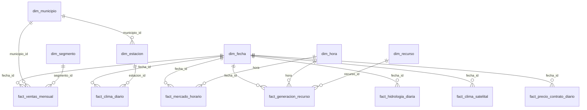

| Hecho | Grano (una fila es…) | Filas |
|---|---|---:|
| `fact_ventas_mensual` | un mes, un municipio, un segmento y un tipo de compra | 4.007 |
| `fact_mercado_horario` | una fecha y una hora (precio de bolsa y demanda), 2015-2026 | 102.984 |
| `fact_generacion_recurso` | una fecha, una hora y una planta | 5.935.449 |
| `fact_hidrologia_diaria` | una fecha (volumen útil y aportes), 2015-2026 | 4.291 |
| `fact_precio_contrato_diario` (EA3) | una fecha (precio promedio de contratos) | 4.201 |
| `fact_clima_diario` | una fecha y una estación del IDEAM | 30.200 |
| `fact_clima_satelital` | una fecha y un punto de NASA POWER | 4.016 |

Dimensiones: `dim_fecha` (un día, con mes, trimestre, día de la semana y **fase ENSO**), `dim_hora` (franja Pico / Media /
Valle), `dim_municipio` (DIVIPOLA), `dim_segmento`, `dim_recurso` (plantas, desde `ListadoRecursos`) y `dim_estacion`.

**Tablas del dashboard (EA3, `dbt/models/dashboard/`):** resumen los hechos y ya traen unidas las dimensiones, para que el
dashboard cargue rápido (por ejemplo, la generación pasa de 5,9 millones de filas a 5.883).

| Tabla | Grano | Filas | Pregunta |
|---|---|---:|---|
| `mart_hidroclima_mensual` | un mes (2015-2026): embalses, aportes, bolsa, contratos, ONI, lluvia y radiación | 141 | 1, 2 y propia |
| `mart_generacion_tipo_diaria` | una fecha y un tipo de planta, con temporada seca y fase ENSO | 5.883 | 3 y propia |
| `mart_mercado_horario` | una fecha y una hora, con día de la semana, mes y franja | 102.984 | 4 |
| `mart_ventas_costo_mensual` | un mes, municipio, segmento y tipo de compra, con 3 costos (real, todo en bolsa, todo por contrato) | 4.007 | 5 |

**Pruebas de dbt (79):** `unique` y `not_null` en las llaves de las dimensiones, `relationships` en todas las llaves de los
hechos y tablas del dashboard, `accepted_values` en las categorías y 6 pruebas propias del **grano** en `dbt/tests/`.

## 📊 Dashboard

**[Abrir el dashboard publicado](https://iud-observatorio-energia-grupo-1.streamlit.app/)** (Streamlit Community Cloud) · código en [`dashboard/app.py`](dashboard/app.py)
y cálculos en [`dashboard/kpis.py`](dashboard/kpis.py), probados con `tests/test_kpis.py`.

Tiene 4 indicadores arriba (embalses, precio de bolsa frente al contrato, ONI y compra en bolsa de EnerAndes) y **una
pestaña por cada pregunta de negocio**, con sus gráficas y un recuadro *"Lo que dicen los datos"* que calcula las cifras
según los filtros. **Filtros:** rango de meses y fase ENSO (todas las pestañas), y municipio, segmento y tipo de compra
(pestaña 5).

| Pestaña | Qué muestra |
|---|---|
| 1 · Riesgo hídrico | Embalses 2015-2026 con los episodios de El Niño marcados y la tabla del mes más crítico de cada uno |
| 2 · Clima y precio | ONI, aportes y precio de bolsa en el tiempo, y la correlación del ONI con el precio a 0…12 meses de rezago |
| 3 · Matriz de generación | Participación de cada fuente por mes, en temporada seca frente a lluvias y según la fase ENSO |
| 4 · Demanda | Mapa de calor hora × día de la semana, curva diaria (pico sombreado) y demanda por mes |
| 5 · Impacto en el negocio | Costo real frente a "todo en bolsa" y "todo por contrato", y energía en bolsa por municipio y segmento |
| 6 · La solar en El Niño | Generación solar y radiación en La Guajira por fase ENSO (pregunta propia) |

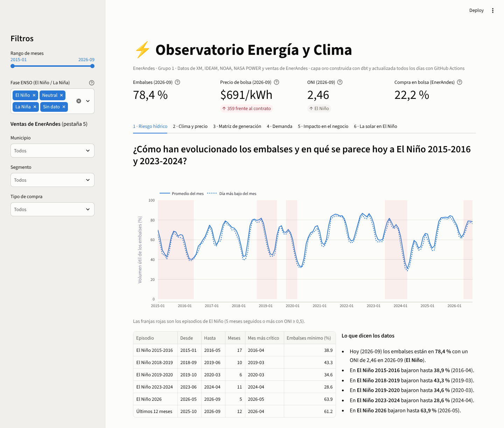
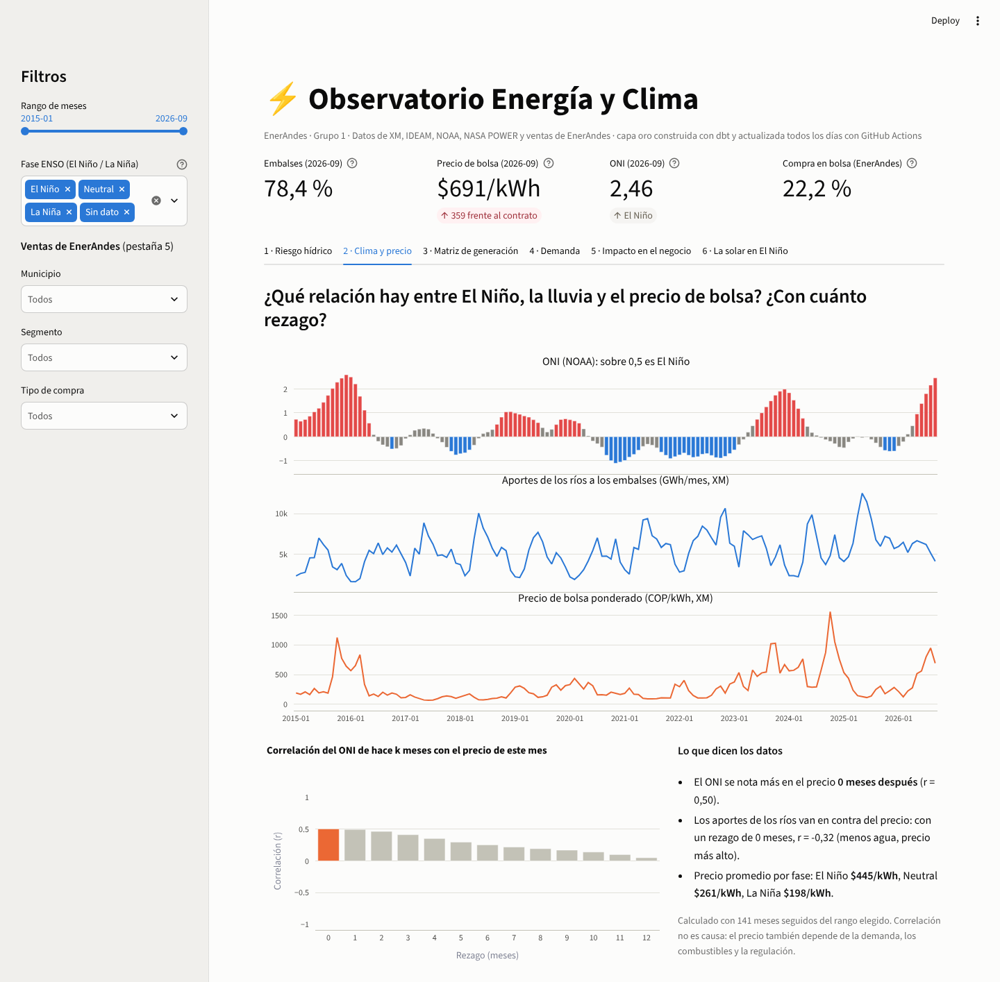
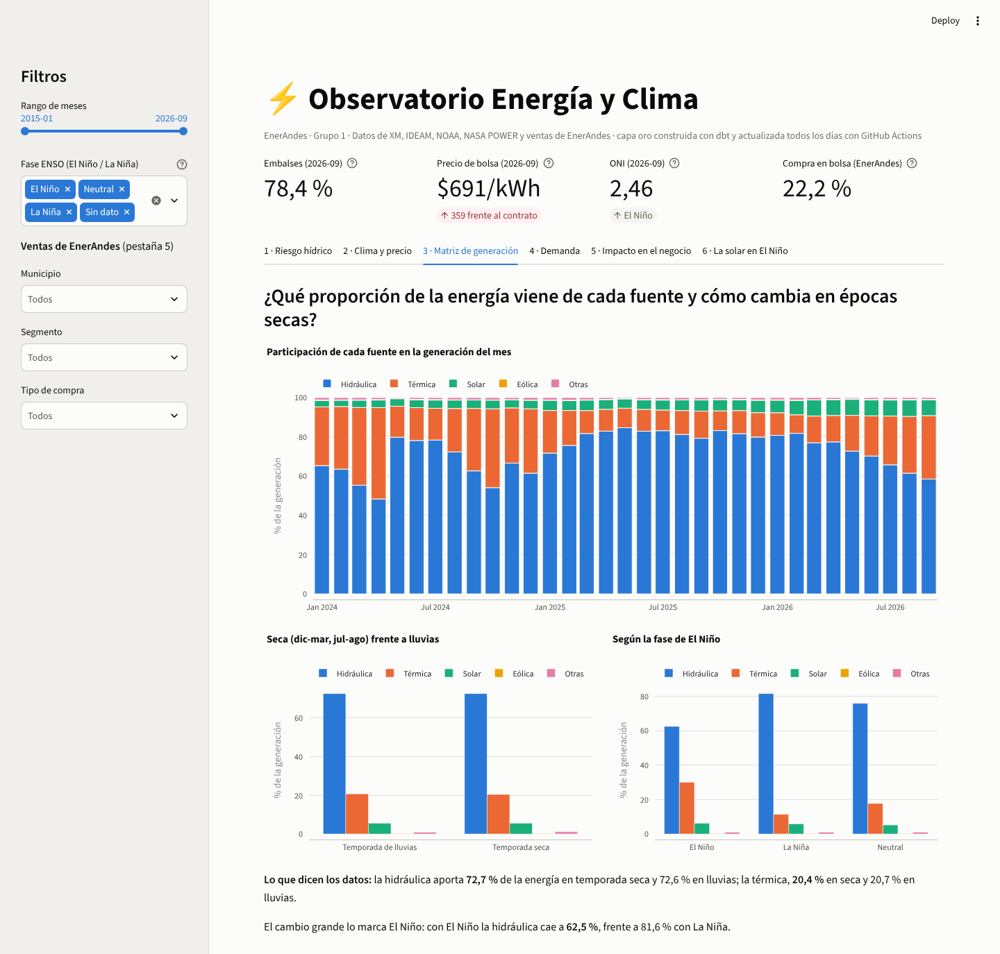
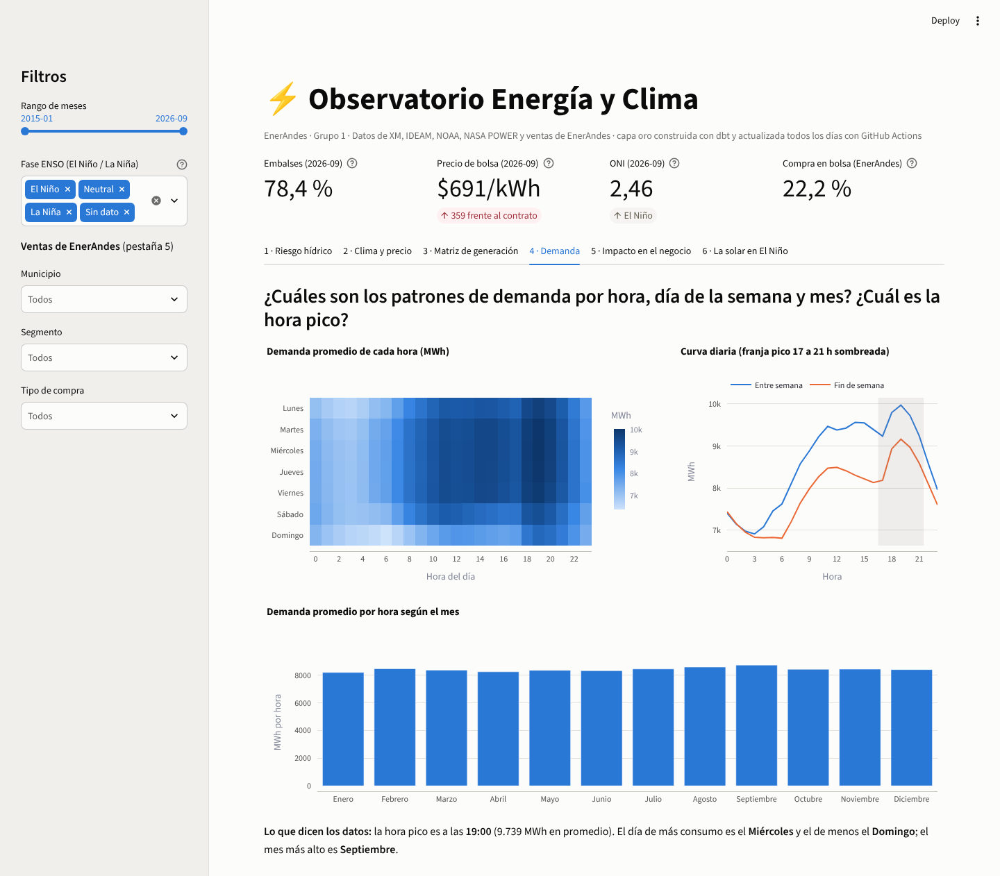
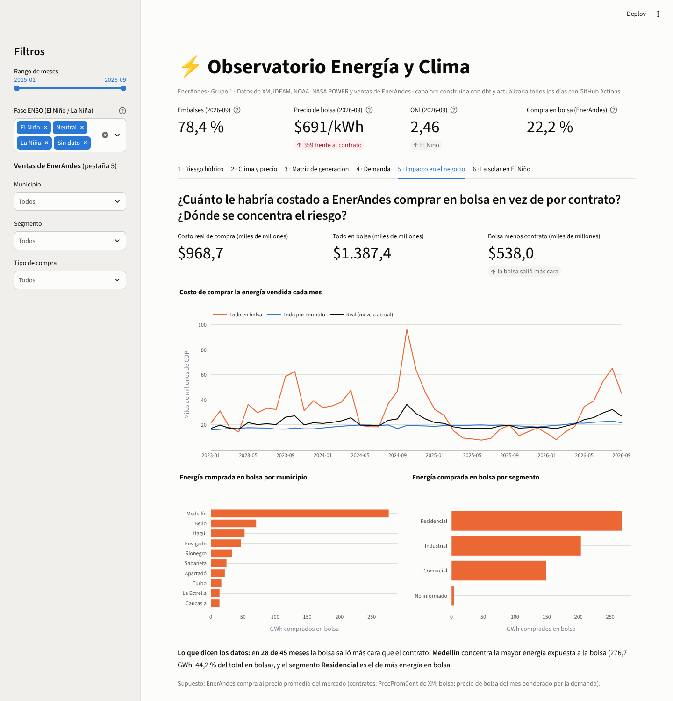
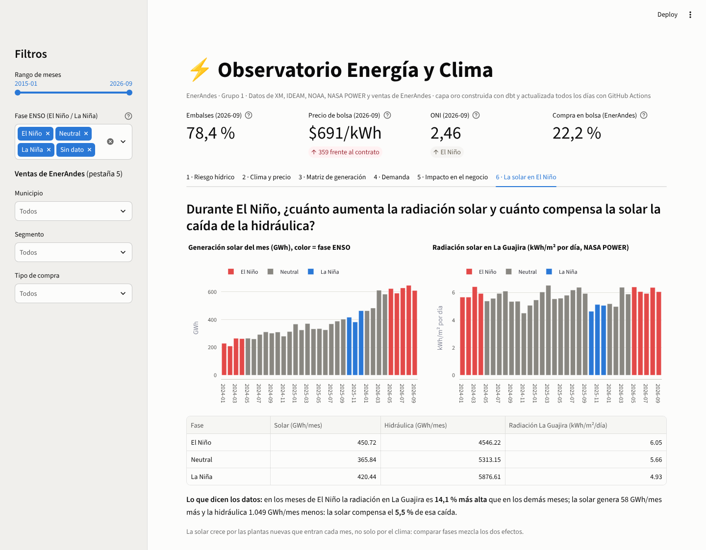

## 💡 Hallazgos principales

El detalle, con sus gráficas, está en el **[informe de hallazgos](docs/informe_final.pdf)** (8 páginas, para la gerencia).

1. **Riesgo hídrico:** El Niño 2026 es el más fuerte desde 2015-2016 (ONI de **2,46** en septiembre). Los embalses están
   en **78,4 %**, casi igual que en septiembre de 2023 (77,4 %), y en ese episodio cayeron al **28,6 %** en abril de 2024,
   el nivel más bajo desde 2015. El momento de mayor riesgo es marzo-abril de 2027.
2. **Clima → precio:** el ONI se nota en el precio **el mismo mes** (r = 0,50) y el efecto dura unos 3 meses. Con El Niño
   la bolsa promedia **$445/kWh**, 2,25 veces el precio de los contratos; con La Niña, $198/kWh. El precio más alto de la
   serie ($1.560/kWh, octubre de 2024) llegó con embalses en 53 %, aun en fase neutral.
3. **Matriz:** la hidráulica produce el 72 % de la energía, pero con El Niño cae al **62,5 %** y la térmica sube al **30,1 %**
   (11,4 % con La Niña). Entre temporada seca y de lluvias casi no cambia: pesa más El Niño que la temporada.
4. **Demanda:** la hora pico es a las **7 p. m.** (10.909 MWh desde 2024); el domingo se consume 13 % menos que un miércoles,
   y la demanda creció **33 %** entre 2015 y 2026. En la franja pico la bolsa es 32 % más cara que en la madrugada.
5. **Negocio:** EnerAndes compra el **22 %** en bolsa en todos los municipios. De enero de 2023 a septiembre de 2026 esa
   parte costó **$119.400 millones más** que contratarla; la bolsa fue más cara en 28 de 45 meses. **Medellín** concentra el
   44 % de la energía en bolsa y el segmento **residencial** el 43 %.
6. **Pregunta propia:** con El Niño la radiación en La Guajira es **23 % mayor**, pero en El Niño 2026 la solar se mantuvo
   plana (~620 GWh/mes) mientras la hidráulica cayó 1.141 GWh: la caída la cubrieron las térmicas.

**Recomendación principal:** bajar la compra en bolsa al **5 %** mientras el ONI esté en 0,5 o más y contratar ya la
energía de diciembre de 2026 a abril de 2027. Con los datos de 2023 a 2026 esa regla habría ahorrado **$64.700 millones
(6,7 %)**. Las 6 recomendaciones están en la sección 5 del informe.

## 📊 Resultados de las consultas (capa oro, EA2)

Las consultas se ejecutan con `python -m src.consultar_oro`. El resultado completo también está disponible en [`docs/resultados_consultas.md`](docs/resultados_consultas.md).

### 1. ¿Cómo cambia el precio de bolsa según la fase de El Niño?

| Año | Fase ENSO | Días | Precio promedio COP/kWh | Precio máximo COP/kWh |
|---:|---|---:|---:|---:|
| 2024 | El Niño | 121 | 624.6 | 1267.6 |
| 2024 | Neutral | 245 | 701.5 | 2675.6 |
| 2025 | La Niña | 92 | 222.8 | 1079.2 |
| 2025 | Neutral | 273 | 246.1 | 2224.0 |
| 2026 | El Niño | 153 | 693.4 | 1846.7 |
| 2026 | Neutral | 120 | 208.0 | 1175.4 |

En 2026, el precio promedio durante El Niño fue de 693,4 COP/kWh, frente a 208,0 COP/kWh en la fase Neutral. Sin embargo, en 2024 el promedio Neutral fue mayor que el de El Niño, por lo que la fase ENSO influye, pero no explica por sí sola el comportamiento del precio.

### 2. ¿Qué proporción de la energía viene de cada tipo de planta, por año?

| Año | Tipo | Generación TWh | Porcentaje |
|---:|---|---:|---:|
| 2024 | HIDRAULICA | 54.49 | 65.4 |
| 2024 | TERMICA | 24.44 | 29.4 |
| 2024 | SOLAR | 3.30 | 4.0 |
| 2024 | COGENERADOR | 0.84 | 1.0 |
| 2024 | EOLICA | 0.15 | 0.2 |
| 2024 | DESCONOCIDO | 0.05 | 0.1 |
| 2025 | HIDRAULICA | 68.10 | 80.7 |
| 2025 | TERMICA | 10.81 | 12.8 |
| 2025 | SOLAR | 4.47 | 5.3 |
| 2025 | COGENERADOR | 0.85 | 1.0 |
| 2025 | EOLICA | 0.15 | 0.2 |
| 2025 | DESCONOCIDO | 0.02 | 0.0 |
| 2026 | HIDRAULICA | 47.53 | 71.5 |
| 2026 | TERMICA | 12.94 | 19.5 |
| 2026 | SOLAR | 5.23 | 7.9 |
| 2026 | COGENERADOR | 0.65 | 1.0 |
| 2026 | EOLICA | 0.16 | 0.2 |
| 2026 | DESCONOCIDO | 0.00 | 0.0 |

La generación hidráulica fue la principal fuente en los tres años. La participación solar aumentó del 4,0 % en 2024 al 7,9 % en 2026. Los valores absolutos de 2026 deben interpretarse considerando que los datos llegan hasta septiembre.

### 3. ¿Cuánto le habría costado a EnerAndes comprar en bolsa la energía de cada año?

| Año | Energía GWh | Costo en bolsa, mil millones COP |
|---:|---:|---:|
| 2024 | 736.6 | 493.2 |
| 2025 | 770.6 | 183.6 |
| 2026 | 595.3 | 287.8 |

Aunque 2025 tuvo la mayor cantidad de energía, presentó el menor costo hipotético debido a los menores precios de bolsa. El costo más alto se obtuvo en 2024, con 493,2 mil millones de pesos.

### 4. ¿Sube la radiación y la generación solar durante El Niño?

| Fase ENSO | Radiación promedio kWh/m² | Generación solar GWh/mes |
|---|---:|---:|
| El Niño | 6.05 | 450.7 |
| Neutral | 5.67 | 365.8 |
| La Niña | 4.93 | 420.4 |

El Niño presentó la mayor radiación promedio y la mayor generación solar mensual. No obstante, La Niña tuvo más generación solar que la fase Neutral, por lo que la relación no es completamente lineal y también intervienen factores como la capacidad instalada y la disponibilidad de las plantas.

## 📂 Estructura del repositorio

```
├── .github/workflows/
│   └── pipeline.yml        # GitHub Actions: pipeline diario, a mano y en cada PR (EA3)
├── dashboard/
│   ├── app.py              # dashboard en Streamlit (EA3)
│   ├── kpis.py             # cálculos del dashboard, probados con pytest
│   ├── actualizar_datos.py # copia las tablas del dashboard a dashboard/datos/
│   ├── datos/              # copia de las 4 tablas del dashboard (la usa Streamlit Cloud)
│   └── requirements.txt    # librerías del dashboard
├── src/
│   ├── config.py           # fechas, URLs, métricas y rutas (todo lo configurable)
│   ├── utils.py            # log, HTTP con reintentos, ventanas, idempotencia, guardar en bronce
│   ├── pipeline.py         # BRONCE: python -m src.pipeline
│   ├── extract/            # un extractor por fuente: xm, ideam, noaa, enerandes, nasa_power
│   ├── transformar.py      # PLATA + ORO: python -m src.transformar
│   ├── exportar_oro.py     # ORO -> data/gold/*.parquet (EA3)
│   ├── silver/             # una limpieza por fuente + comun.py (medir, cuarentena, guardar) + reporte.py
│   ├── quality/            # esquemas de pandera de cada tabla de plata
│   ├── muestras.py         # genera data/sample/
│   ├── perfilamiento.py    # genera docs/perfilamiento.md
│   └── consultar.py        # consultas SQL con DuckDB
├── dbt/
│   ├── dbt_project.yml     # proyecto dbt (rango de fechas en vars)
│   ├── profiles.yml        # conexión: data/observatorio.duckdb
│   ├── models/staging/     # lee cada tabla de la capa plata
│   ├── models/marts/       # dimensiones, hechos y schema.yml (grano, descripciones y pruebas)
│   ├── models/dashboard/   # tablas resumidas para el dashboard (EA3)
│   └── tests/              # pruebas del grano de los hechos
├── tests/                  # pruebas con pytest (bronce y plata)
├── data/
│   ├── insumos/            # Excel interno de EnerAndes
│   ├── bronze/ silver/     # capas bronce y plata (NO se suben a GitHub)
│   └── sample/             # 200 filas de cada archivo de bronce, en CSV
├── consultas/              # SQL de ejemplo (EA1) y consultas/oro/ (EA2)
└── docs/
    ├── perfilamiento.md        # perfil de bronce + hallazgos (EA1)
    ├── reporte_calidad.md      # reglas de plata con su antes y después (EA2, generado)
    ├── modelo_dimensional.md   # diagrama y grano del esquema estrella (EA2)
    ├── diccionario_datos.md    # columnas de cada tabla de oro (EA2)
    ├── informe_final.pdf       # informe de hallazgos para la gerencia (EA3)
    └── bitacoras/              # una bitácora por integrante
```

## 🧪 Pruebas automáticas

`python -m pytest` ejecuta **41 pruebas** con datos de ejemplo pequeños escritos en cada prueba (en GitHub Actions corren
en cada ejecución):

| Archivo | Qué comprueba | Entrega |
|---|---|---|
| `test_ventanas.py` | Que `ventanas()` parta bien un rango de fechas (incluido el año bisiesto), sin huecos ni días repetidos | EA1 |
| `test_aplanar.py` | Que `aplanar()` convierta bien el JSON de XM por hora, por día y de listas | EA1 |
| `test_idempotencia.py` | Que `ya_existe()` omita los archivos que ya están y los descargue de nuevo con `--forzar` | EA1 |
| `test_limpieza.py` | Las reglas de la clase: tildes, alias de municipios, totales, duplicados, cuarentena y pandera | EA2 (clase) |
| `test_noaa.py` | Umbrales de la fase ENSO, trimestre móvil → mes central y que pandera rechace una fase inventada | EA2 |
| `test_nasa_power.py` | Que el −999 de NASA quede vacío y que pase a una fila por punto y día | EA2 |
| `test_reglas_plata.py` | Fechas en 4 formatos (`mar-24`, `03/2024`, `01/03/2026` = marzo), MWh a kWh y XM de 24 columnas a una fila por hora | EA2 |
| `test_exportar_oro.py` | Que la exportación cree un Parquet por tabla con sus filas, y el resumen de Actions | EA3 |
| `test_historia_xm.py` | Que el sistema de XM se pida desde 2015 y las plantas no, y la limpieza del precio de contratos | EA3 |
| `test_tablas_oro.py` | Que la lista de tablas exportadas coincida con los modelos de dbt | EA3 |
| `test_kpis.py` | Los cálculos del dashboard: rezago del ONI, hora pico, costos, exposición a bolsa, episodios de El Niño y participación | EA3 |
| `test_calidad_contratos.py` | Que un precio de contratos imposible (0,045 COP/kWh) vaya a cuarentena y pandera lo rechace | EA3 |

Además, `dbt build` corre **79 pruebas** sobre la capa oro (ver arriba).

### 📸 Capturas de la consola (EA1: capa bronce)

Pipeline completo desde un clon nuevo (la salida es larga, por eso va en tres partes):

**1. Inicio y XM** (6 métricas en ventanas de 30 días)

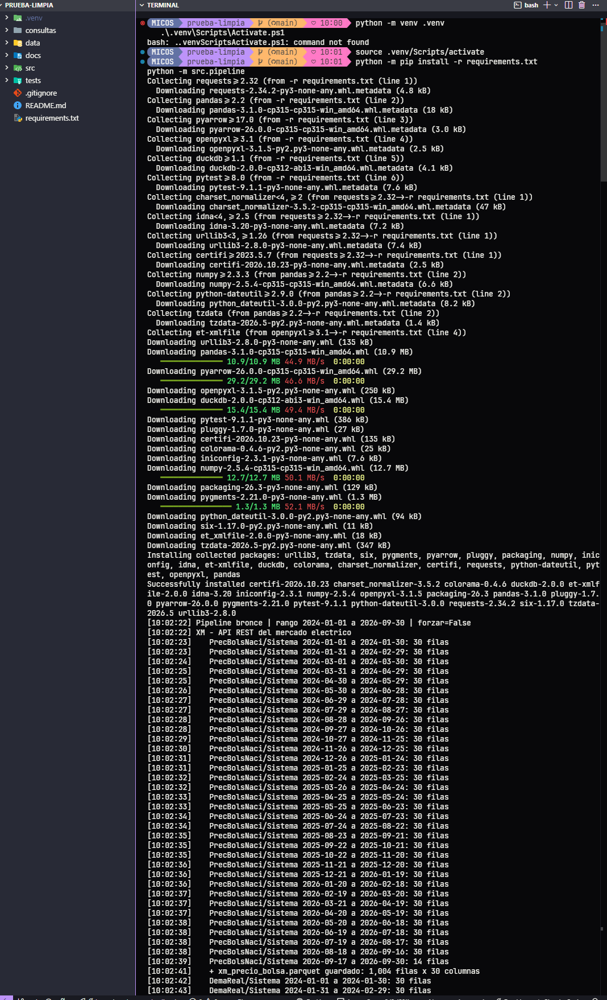

**2. IDEAM** (precipitación y temperatura por semanas; las "0 filas" del final son el rezago de publicación)

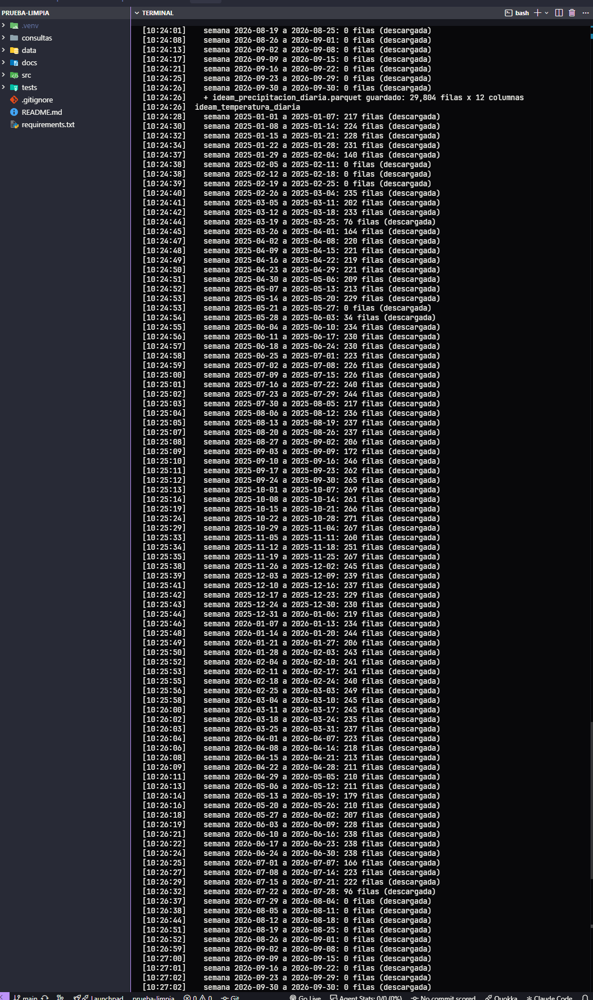

**3. NOAA, EnerAndes, NASA POWER y resumen de la capa bronce**

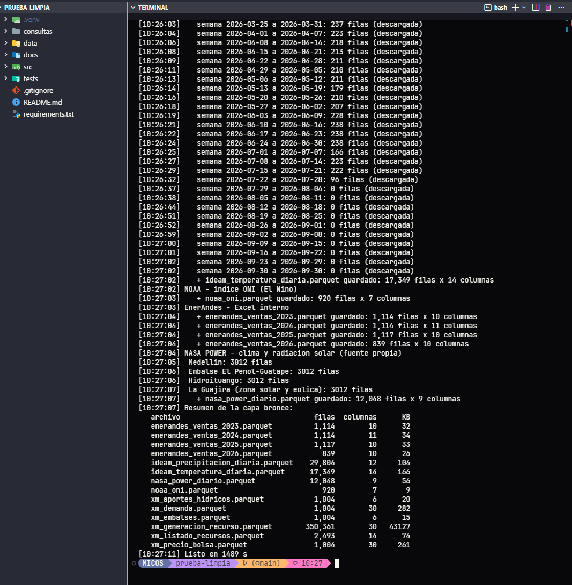

Pruebas automáticas:

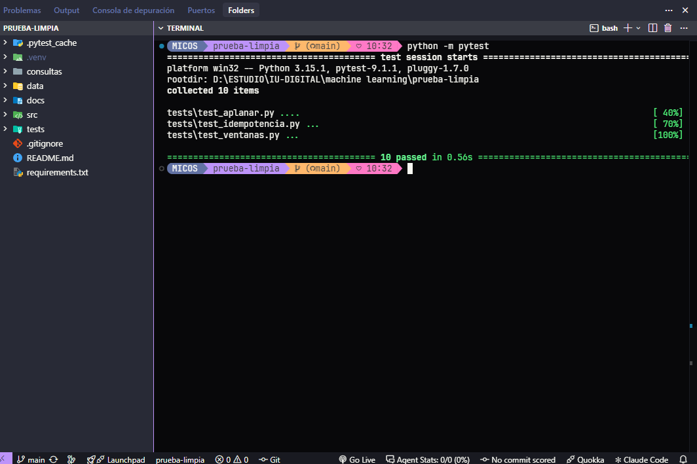

## 📸 Evidencias de la EA3

**1. El workflow se ejecuta solo y en verde.** Pestaña *Actions*: ejecuciones diarias (`schedule`), a mano
(`workflow_dispatch`) y de cada Pull Request, todas en verde.

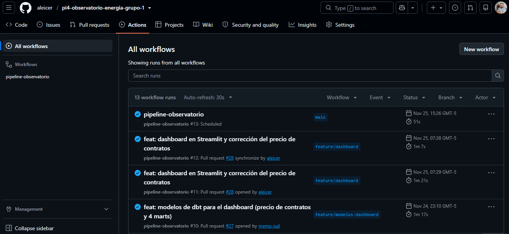

**2. Una ejecución por dentro.** Los pasos en orden (bronce, plata, oro, pruebas, exportar), el resumen con las filas de
cada tabla de la capa oro y los artefactos `capa-oro` y `reporte-calidad` listos para descargar.

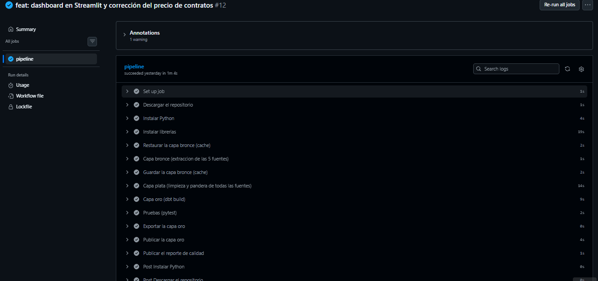

**3. Las 41 pruebas con pytest** (las 25 de las EA1 y EA2 y las 16 nuevas de la EA3), que también corren en cada ejecución
del workflow.

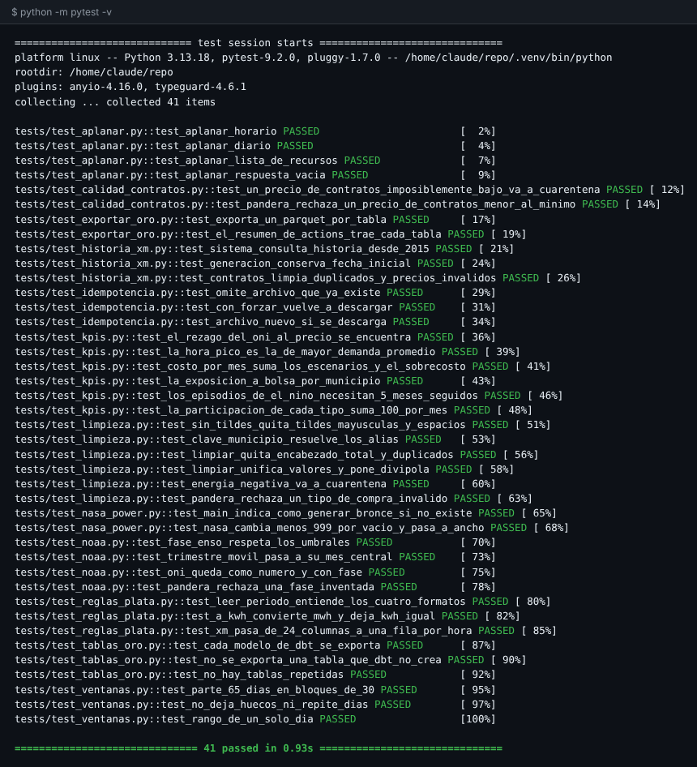

**4. El dashboard publicado en Streamlit Community Cloud**: <https://iud-observatorio-energia-grupo-1.streamlit.app/>

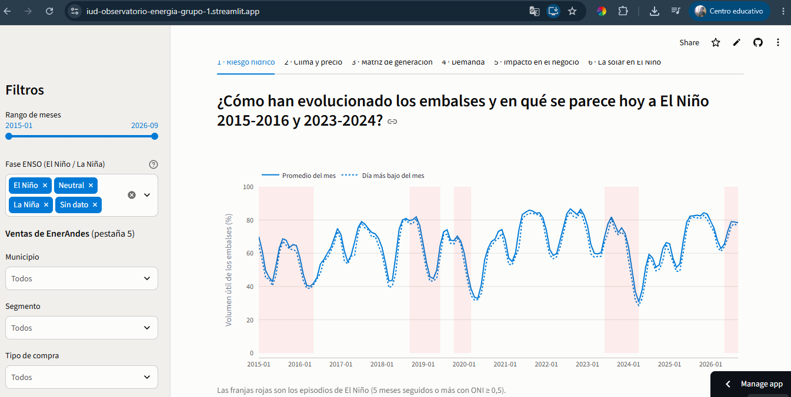

**5. El hallazgo de calidad en el dashboard.** El precio de contratos de 0,045 COP/kWh de abril a junio de 2026 se veía
como una caída imposible en la pestaña 5; después de la regla nueva, los meses sin precio válido usan el del último mes con
dato (ver [Capa plata](#-capa-plata-calidad-de-datos)).

## 🤝 Trabajo colaborativo

- La rama `main` está protegida: todo cambio entra por Pull Request aprobado por otro integrante.
- Una rama por tarea (`feature/plata-enerandes`, `feature/plata-noaa`, `test/reglas-plata`, `feature/oro-estrella`…) y commits con prefijos `feat:`, `fix:`, `test:`, `docs:`.
- Tareas en el tablero de GitHub Projects, como issues asignados a cada integrante.
- Bitácoras individuales en [`docs/bitacoras/`](docs/bitacoras/).
- **EA3:** los roles rotaron (ver [Integrantes](#-integrantes)). Pull Requests de la entrega: #23 (roles y preguntas),
  #24 y #25 (workflow e historia de XM), #26 (insignia), #27 (modelos del dashboard), #28 (dashboard y corrección del precio
  de contratos) y los de la documentación final (informe, README y bitácoras). Cada PR corre el workflow completo antes de
  aprobarse.

## 🎥 Videos de sustentación

La EA2 y la EA3 no piden video de sustentación; en la EA3 el trabajo se documenta con capturas de los pasos importantes
(ver [Evidencias de la EA3](#-evidencias-de-la-ea3)). Estos son los videos de la EA1:


| Integrante | Video |
|---|---|
| Aleicer Vesga Rueda | [Ver video](https://drive.google.com/file/d/163Wuja0SsmBLQEGa1KERaVIvo3C-EkqF/view?usp=drivesdk) |
| Jaider Morales | [Ver video](https://drive.google.com/file/d/1ZDGnIt2TOh8p0XkoftEHaWsDAKZ9k53b/view?usp=sharing) |
| Guillermo León Loaiza | [Ver video](https://drive.google.com/file/d/1T8Tba5aNBp9DUU-63DiCZsT3N2LP0xPE/view?usp=sharing) |

## 🤖 Uso de IA

El equipo usó **Claude (Anthropic)** como asistente durante las tres entregas, para:

- Planear cada entrega, repartir las tareas del equipo y preparar guías de trabajo para cada integrante.
- Proponer y revisar código: los extractores (EA1); las limpiezas de la capa plata, los esquemas de pandera, el comando `src.transformar` y el modelo dbt (EA2); y ejemplos de pruebas con pytest.
- Revisar el estado de las ramas y los Pull Requests, y explicar errores durante la ejecución.
- **EA3:** proponer el workflow de GitHub Actions (caché de la capa bronce, ejecución diaria y en cada PR), la ampliación de
  XM desde 2015, los modelos de dbt del dashboard, el código del dashboard en Streamlit con sus pruebas, y apoyar la
  redacción del informe de hallazgos a partir de los números que sacamos de la capa oro.
- Revisar los resultados con los datos reales: así encontramos el precio de contratos de 0,045 COP/kWh de 2026 y lo
  corregimos con una regla y una prueba.

**Qué no hizo la IA:** no descargó datos ni inventó cifras. Todos los números del dashboard, del informe y de este README
salen de la ejecución real del pipeline (GitHub Actions y nuestros computadores). Las decisiones de qué recomendar a la
gerencia y el supuesto del precio de compra de EnerAndes las revisó y aprobó el equipo.

Todo el código se ejecutó y revisó por el equipo antes de cada Pull Request, y cada integrante entiende y puede explicar la parte que construyó. Los datos, las métricas de calidad y los resultados salen de la ejecución real del pipeline.

## ⚠️ Limitaciones y trabajo futuro

- **Precio de compra de EnerAndes:** no tenemos sus contratos reales; se supone que compra al precio promedio del mercado
  (`PrecPromCont` de XM y bolsa ponderada por la demanda). Los costos de la pregunta 5 son una estimación.
- **Precio de contratos de mayo y junio de 2026:** XM lo reportó con un error; se usa el del último mes válido (abril).
- **Periodos cortos:** la generación por planta y NASA POWER empiezan en 2024 y el IDEAM en 2025 (solo Antioquia, y con
  rezago de publicación): la matriz y la pregunta solar se basan en un episodio de El Niño más el actual.
- **Ventas:** la parte en bolsa es 22 % en todos los municipios, segmentos y años, lo que sugiere que el Excel del reto es un
  conjunto preparado.
- **Correlación no es causa:** el precio también depende de la demanda, los combustibles, el mantenimiento de plantas y la
  regulación.
- **Trabajo futuro:** pronóstico del precio de bolsa con el ONI y los embalses; alertas automáticas (por ejemplo, un
  mensaje cuando el ONI pase de 0,5 y los embalses bajen del 55 %); cargar las compras reales de EnerAndes; y ampliar la
  generación por planta a 2015 para comparar la matriz con más episodios de El Niño.
