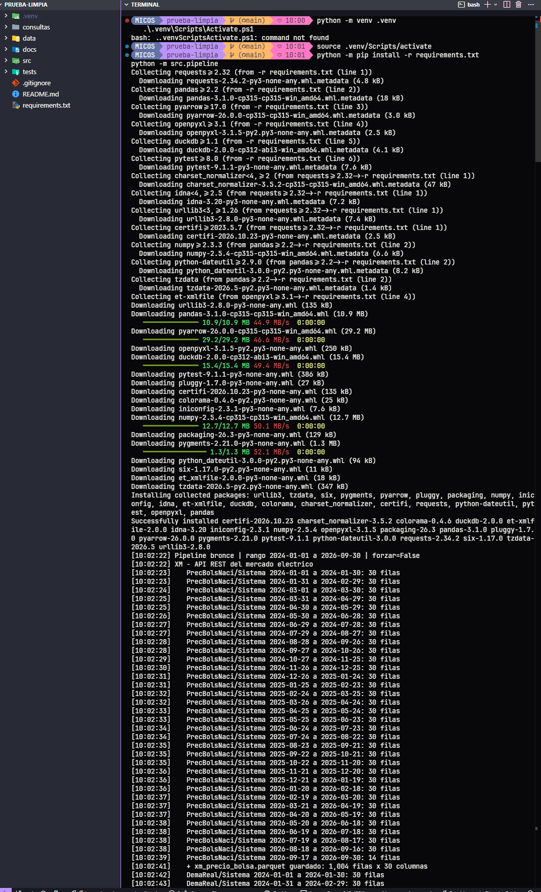
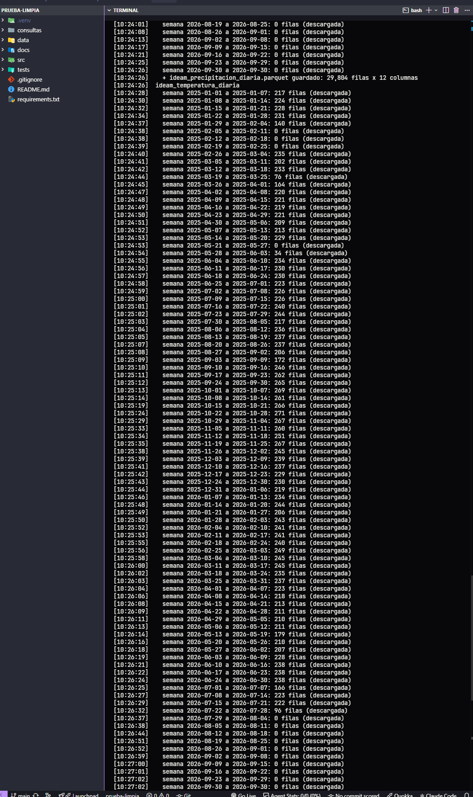
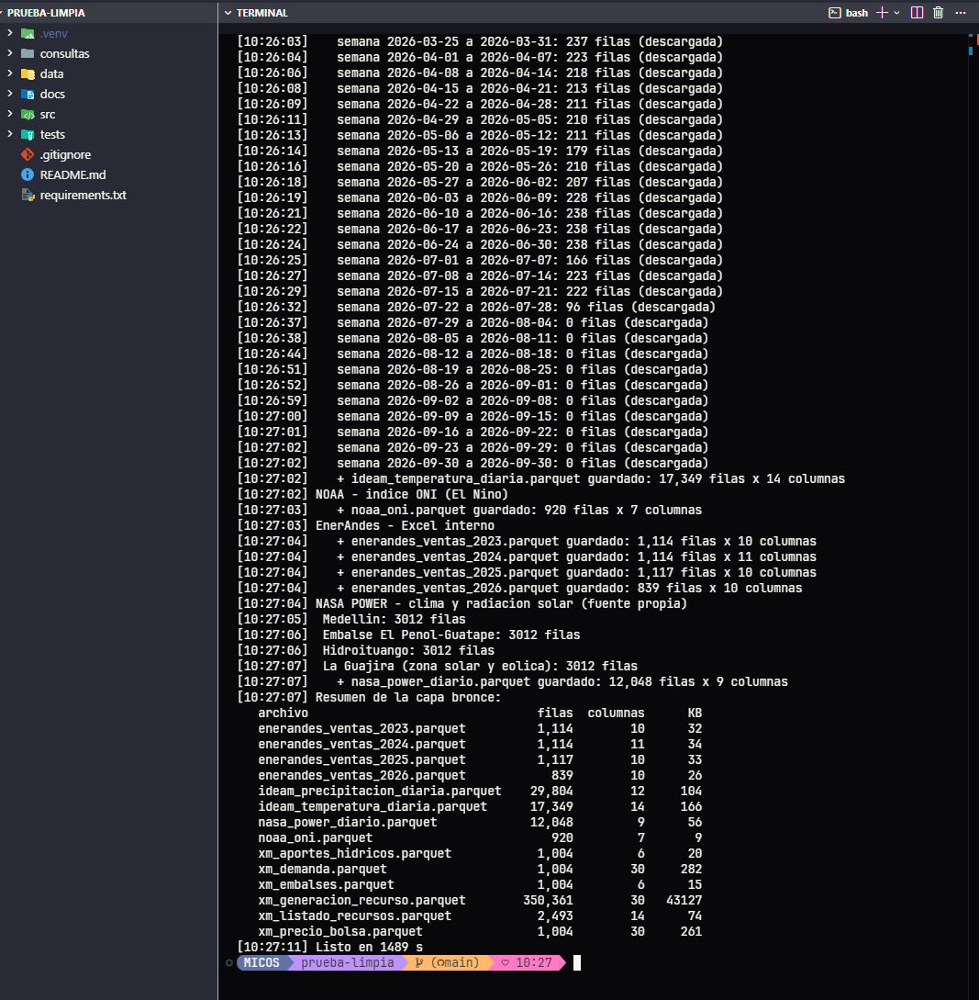
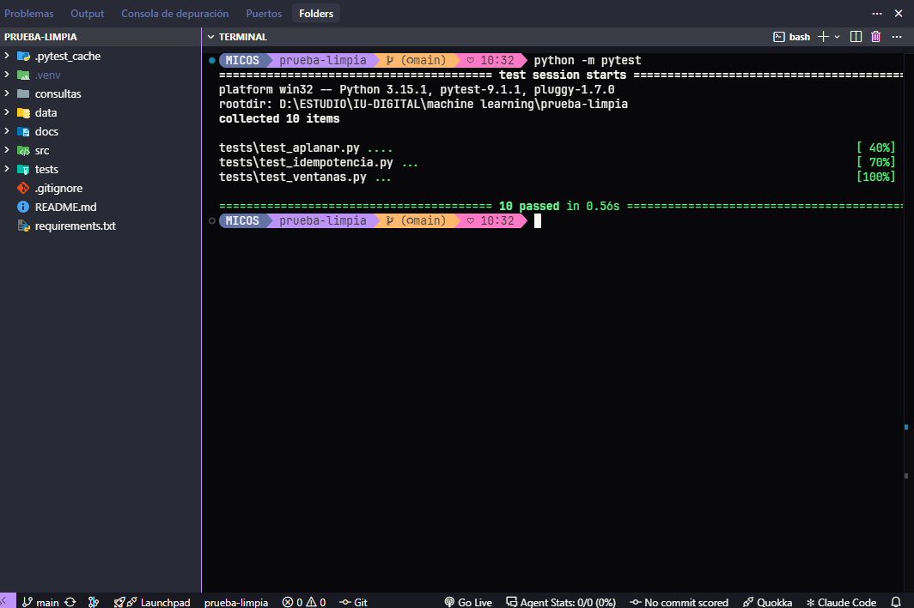

# Observatorio Energía y Clima – Grupo 1

> Proyecto Integrado IV – Integración de Información · IU Digital de Antioquia · 2026-2
> Entrega: **EA1 – Extracción de datos de fuentes reales con Python** (capa bronce) · tag `ea1`

## 👥 Integrantes

| Nombre | Usuario GitHub | Rol | Qué construyó en la EA1 |
|---|---|---|---|
| Aleicer Vesga Rueda | [@aleicer](https://github.com/aleicer) | Líder técnico / Data Engineer y Analytics Engineer | Ampliación de XM (6 métricas + `ListadoRecursos`), IDEAM (precipitación y temperatura), muestras, script de perfilamiento, README y merges |
| Jaider Morales | [@JaiderMoraless](https://github.com/JaiderMoraless) | Data Quality Analyst | Pruebas automáticas con pytest (`tests/`) y hallazgos de calidad del perfilamiento |
| Guillermo León Loaiza | [@memo-iud](https://github.com/memo-iud) | BI Analyst / Storyteller | Fuente propia NASA POWER (`src/extract/nasa_power.py`) y su documentación |

Como el equipo tiene 3 integrantes y el reto define 4 roles, Aleicer asume también el de Analytics Engineer (modelo dimensional de la EA2).

## 🎯 Objetivo

Construir la base del **Observatorio de Energía y Clima** para la comercializadora EnerAndes: un pipeline en Python que extrae datos de cinco fuentes reales (mercado eléctrico, clima, El Niño, ventas internas y una fuente propia) y los guarda **tal como llegan**, en Parquet y con el registro de su origen. Esta es la **capa bronce**: sobre ella, en la EA2, se limpiarán y modelarán los datos para analizar el riesgo de precios altos y desabastecimiento ante El Niño 2026.

## 🏗️ Arquitectura

```
Fuentes ──> BRONCE (dato tal cual + linaje) ──> PLATA (limpio) ──> ORO (modelo estrella) ──> Dashboard
            ▲ esta entrega
```

Reglas de la capa bronce que sigue el código:

1. **No se modifica nada:** cada fuente se guarda como llega (casi todo como texto). Limpiar es trabajo de la capa plata.
2. **Linaje:** cada archivo trae 3 columnas extra: `_fuente`, `_origen` (URL o archivo exacto) y `_extraido_en` (fecha y hora UTC).
3. **Idempotencia:** si un archivo ya existe en `data/bronze/`, el pipeline lo omite. Con `--forzar` se descarga de nuevo.
4. **Reintentos:** las peticiones HTTP se repiten hasta 4 veces, esperando 2, 4 y 8 segundos.

## 📦 Fuentes de datos (capa bronce)

| # | Fuente | Tipo | Qué se extrae | Rango | Archivo(s) en `data/bronze/` | Filas |
|---|---|---|---|---|---|---:|
| 1 | **XM – API Sinergox** | API REST (POST, JSON), ventanas de 30 días | Precio de bolsa (hora) | 2024-01-01 a 2026-09-30 | `xm_precio_bolsa` | 1.004 |
| | | | Demanda real (hora) | 2024-01-01 a 2026-09-30 | `xm_demanda` | 1.004 |
| | | | Generación por planta, `Gene`/`Recurso` (hora) | 2024-01-01 a 2026-09-30 | `xm_generacion_recurso` | 350.345 |
| | | | % volumen útil de embalses (día) | 2024-01-01 a 2026-09-30 | `xm_embalses` | 1.004 |
| | | | Aportes hídricos, `AporEner` (día) | 2024-01-01 a 2026-09-30 | `xm_aportes_hidricos` | 1.004 |
| | | endpoint `lists`, sin fechas | Catálogo de plantas, `ListadoRecursos` | foto del día de descarga | `xm_listado_recursos` | 2.494 |
| 2 | **IDEAM – datos.gov.co** | API Socrata (SoQL), agregación en el servidor, semanas de 7 días | Precipitación diaria por estación (`sum`) | 2025-01-01 a 2026-09-30 * | `ideam_precipitacion_diaria` | 29.804 |
| | | | Temperatura media, mínima y máxima por estación (`avg`, `min`, `max`) | 2025-01-01 a 2026-09-30 * | `ideam_temperatura_diaria` | 17.349 |
| 3 | **NOAA – índice ONI** | Archivo de texto | Anomalía de temperatura del Pacífico (El Niño / La Niña) | 1950 – 2026 | `noaa_oni` | 920 |
| 4 | **EnerAndes** | Excel interno (una hoja por año) | Ventas mensuales por municipio, segmento y tipo de compra | 2023 – 2026 | `enerandes_ventas_2023` … `_2026` | 4.184 |
| 5 | **NASA POWER** (fuente propia) | API REST (GET, JSON) | Radiación solar, temperatura y lluvia diaria en 4 puntos | 2024-01-01 a 2026-09-30 | `nasa_power_diario` | 12.048 |

\* Se piden datos hasta el 30 de septiembre, pero el IDEAM solo ha publicado hasta el 24 de julio de 2026 (ver hallazgo H3 del perfilamiento).

**Sobre el IDEAM:** los datasets tienen millones de mediciones (una cada pocos minutos). El filtro (`$where`, solo Antioquia y la semana) y el resumen por estación y día (`$select` + `$group`) los hace el **servidor**, así que solo viajan los resúmenes. Como son 92 semanas por dataset, cada semana se guarda en una carpeta temporal: si la descarga se corta, al volver a ejecutar continúa donde iba.

### 🛰️ Fuente propia: NASA POWER

**Qué es:** servicio gratuito de la NASA con datos diarios de clima y energía solar, calculados con satélites y modelos, para cualquier punto del planeta.

**De dónde viene:** API REST <https://power.larc.nasa.gov/api/temporal/daily/point> (sin usuario ni clave). Script: `src/extract/nasa_power.py` → `data/bronze/nasa_power_diario.parquet`.

**Qué descargamos:** radiación solar (`ALLSKY_SFC_SW_DWN`), temperatura (`T2M`) y lluvia (`PRECTOTCORR`), del 1-ene-2024 al 30-sep-2026, en Medellín, el embalse Peñol-Guatapé, Hidroituango y La Guajira.

**Para qué la usaremos:** responder la **pregunta propia del equipo**: *durante El Niño 2026, ¿cuánto aumentó la radiación solar y cuánto compensó la generación solar la caída de la hidráulica?* Se cruza con XM (generación por planta + catálogo de plantas) y NOAA (ONI). Además cubre los meses recientes que el IDEAM todavía no publica.

## ⚙️ Cómo ejecutar (desde cero)

Requisitos: **Python 3.11 o superior** y Git. En Windows, con PowerShell:

```powershell
git clone https://github.com/aleicer/pi4-observatorio-energia-grupo-1.git
cd pi4-observatorio-energia-grupo-1
python -m venv .venv
.\.venv\Scripts\Activate.ps1          # en Git Bash: source .venv/Scripts/activate
python -m pip install -r requirements.txt

python -m src.pipeline                # descarga las 5 fuentes a data/bronze/
python -m pytest                      # pruebas automáticas
```

- La **primera ejecución tarda entre 20 y 25 minutos**: XM unos 5 minutos y el IDEAM el resto (es la fuente más lenta). Las siguientes terminan en segundos, porque omiten lo que ya existe.
- El Excel de EnerAndes ya viene en `data/insumos/`; no hay que copiar nada.
- Para descargar todo de nuevo: `python -m src.pipeline --forzar`. Para una sola fuente: `python -m src.extract.xm` (también `ideam`, `noaa`, `enerandes`, `nasa_power`).
- Las fechas, URLs y métricas se cambian en un solo lugar: `src/config.py`.

Comandos adicionales:

| Comando | Qué hace |
|---|---|
| `python -m src.muestras` | Regenera `data/sample/` con las primeras 200 filas de cada archivo de bronce, en CSV |
| `python -m src.perfilamiento` | Regenera las tablas de `docs/perfilamiento.md` (conserva los hallazgos escritos a mano) |
| `python -m src.consultar` | Ejecuta las consultas SQL de `consultas/` con DuckDB, directo sobre los Parquet |

> Si PowerShell no deja activar el entorno: `Set-ExecutionPolicy -Scope CurrentUser RemoteSigned`.

### 📸 Capturas de la consola

Pipeline completo desde un clon nuevo (la salida es larga, por eso va en tres partes):

**1. Inicio y XM** (6 métricas en ventanas de 30 días)



**2. IDEAM** (precipitación y temperatura por semanas; las "0 filas" del final son el rezago de publicación)



**3. NOAA, EnerAndes, NASA POWER y resumen de la capa bronce**



Pruebas automáticas:



## 📂 Estructura del repositorio

```
├── src/
│   ├── config.py           # fechas, URLs, métricas y rutas (todo lo configurable)
│   ├── utils.py            # log, HTTP con reintentos, ventanas, idempotencia, guardar en bronce
│   ├── pipeline.py         # punto de entrada: python -m src.pipeline
│   ├── extract/            # un extractor por fuente: xm, ideam, noaa, enerandes, nasa_power
│   ├── muestras.py         # genera data/sample/
│   ├── perfilamiento.py    # genera docs/perfilamiento.md
│   └── consultar.py        # consultas SQL con DuckDB
├── tests/                  # pruebas con pytest
├── data/
│   ├── insumos/            # Excel interno de EnerAndes
│   ├── bronze/             # capa bronce (NO se sube a GitHub, se regenera con el pipeline)
│   └── sample/             # 200 filas de cada archivo de bronce, en CSV
├── consultas/              # SQL de ejemplo para BI
└── docs/
    ├── perfilamiento.md    # perfil de cada archivo + hallazgos de calidad
    └── bitacoras/          # una bitácora por integrante
```

## ✅ Perfilamiento y calidad

[`docs/perfilamiento.md`](docs/perfilamiento.md) tiene una tabla por cada archivo de bronce con filas, columnas, tipos de datos, % de nulos por columna, filas duplicadas y rango de fechas, y al final **6 hallazgos de calidad** con su evidencia numérica. Algunos ejemplos:

- El IDEAM publica con rezago: los datos llegan solo hasta el 24 de julio de 2026 (68 días menos de lo pedido).
- Cada hoja de EnerAndes trae filas duplicadas (32 por año en 2023 a 2025 y 24 en 2026).
- En la generación por planta de XM, cerca del 52 % de las horas nocturnas vienen vacías, frente a menos del 7 % al mediodía.

## 🧪 Pruebas automáticas

`python -m pytest` ejecuta **10 pruebas** en `tests/`:

| Archivo | Qué comprueba |
|---|---|
| `test_ventanas.py` | Que `ventanas()` parta bien un rango de fechas (incluido el año bisiesto), sin huecos ni días repetidos |
| `test_aplanar.py` | Que `aplanar()` convierta bien el JSON de XM por hora, por día y de listas, sin cambiar los valores |
| `test_idempotencia.py` | Que `ya_existe()` omita los archivos que ya están y los descargue de nuevo con `--forzar` |

## 🤝 Trabajo colaborativo

- La rama `main` está protegida: todo cambio entra por Pull Request aprobado por otro integrante.
- Una rama por tarea (`feature/extract-xm`, `test/pruebas-unitarias`, `docs/fuente-propia`…) y commits con prefijos `feat:`, `fix:`, `test:`, `docs:`.
- Tareas en el tablero de GitHub Projects, como issues asignados a cada integrante.
- Bitácoras individuales en [`docs/bitacoras/`](docs/bitacoras/).

## 🎥 Videos de sustentación (EA1)

| Integrante | Video |
|---|---|
| Aleicer Vesga Rueda | _(pendiente)_ |
| Jaider Morales | _(pendiente)_ |
| Guillermo León Loaiza | _(pendiente)_ |

## 🤖 Uso de IA

El equipo usó **Claude (Anthropic)** como asistente durante la EA1, para:

- Planear la entrega y repartir las tareas del equipo, y preparar guías de trabajo para cada integrante.
- Proponer y revisar código: la ampliación de los extractores de XM e IDEAM, los scripts de muestras y perfilamiento, y ejemplos de pruebas con pytest.
- Explicar errores durante la ejecución (por ejemplo, la diferencia entre ejecutar un archivo y ejecutarlo como módulo con `python -m`).

Todo el código se ejecutó y revisó por el equipo antes de cada Pull Request. Los datos, los resultados y los hallazgos salen de la ejecución real del pipeline, y cada integrante explica en su video la parte que construyó.
