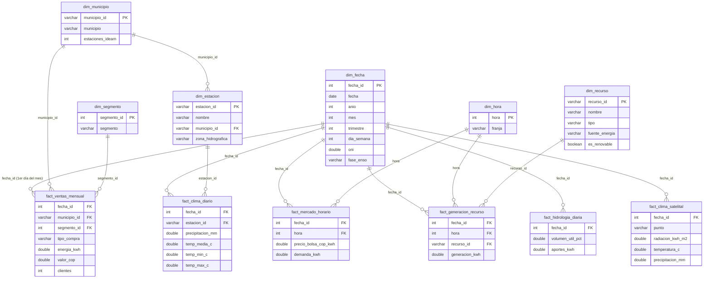

# Modelo dimensional – capa oro

La capa oro organiza los datos limpios de la capa plata en un **esquema estrella** (una constelación de hechos que
comparten dimensiones), construido con **dbt** sobre **DuckDB** (`data/observatorio.duckdb`).

- **6 tablas de hechos:** lo que se mide (precio, demanda, generación, ventas, clima…).
- **6 dimensiones:** el contexto con que se filtra y agrupa (cuándo, a qué hora, dónde, qué planta, qué segmento, qué estación).
- Se construye con `python -m src.transformar` (o solo la capa oro: `dbt build --project-dir dbt --profiles-dir dbt`).
- `dbt build` corre **76 pruebas**: `unique` y `not_null` en las llaves de las dimensiones, `relationships` en cada llave de
  los hechos, `accepted_values` en las categorías y 4 pruebas propias del **grano** (`dbt/tests/`).

## Diagrama

## Grano de cada tabla de hechos

El **grano** dice qué representa **una fila**. Es la decisión más importante del modelo: define qué preguntas se pueden
responder y cómo se suman las medidas.

| Hecho | Grano (una fila es…) | Medidas | Filas | Fuente |
|---|---|---|---:|---|
| `fact_ventas_mensual` | un **mes**, un **municipio**, un **segmento** y un **tipo de compra** | `energia_kwh`, `valor_cop`, `clientes` | 4.007 | Excel de EnerAndes (4 hojas) |
| `fact_mercado_horario` | una **fecha** y una **hora** | `precio_bolsa_cop_kwh`, `demanda_kwh` | 24.096 | XM |
| `fact_generacion_recurso` | una **fecha**, una **hora** y una **planta** | `generacion_kwh` | 5.935.362 | XM |
| `fact_hidrologia_diaria` | una **fecha** | `volumen_util_pct`, `aportes_kwh` | 1.004 | XM |
| `fact_clima_diario` | una **fecha** y una **estación** del IDEAM | `precipitacion_mm`, `temp_media_c`, `temp_min_c`, `temp_max_c` | 30.200 | IDEAM |
| `fact_clima_satelital` | una **fecha** y un **punto** | `radiacion_kwh_m2`, `temperatura_c`, `precipitacion_mm` | 4.016 | NASA POWER (fuente propia) |

Notas sobre el grano:

- **Ventas mensuales y fechas diarias:** las ventas son mensuales, pero `dim_fecha` es diaria. Cada venta se une con el
  **primer día de su mes** (`2024-03` → `fecha_id = 20240301`); para analizar ventas se agrupa por `anio` y `mes`.
- **Generación:** las horas en que una planta no reportó (sobre todo las solares de noche) no están en la tabla: no son una
  medición. Sumar `generacion_kwh` da la energía real generada.
- **Clima del IDEAM:** una estación puede medir solo lluvia o solo temperatura; en ese caso la otra medida queda vacía.
- Cada grano tiene su prueba en `dbt/tests/assert_grano_*.sql`: la prueba falla si dos filas tienen la misma llave.

## Dimensiones

| Dimensión | Grano | Llave | De dónde viene |
|---|---|---|---|
| `dim_fecha` | un día (2023-01-01 a 2026-09-30) | `fecha_id` (AAAAMMDD) | Generada en dbt; `oni` y `fase_enso` vienen de NOAA |
| `dim_hora` | una hora (0 a 23) con su franja Pico / Media / Valle | `hora` | Generada en dbt |
| `dim_municipio` | un municipio con ventas de EnerAndes | `municipio_id` (DIVIPOLA) | Ventas de EnerAndes + estaciones del IDEAM |
| `dim_segmento` | un segmento de cliente | `segmento_id` | Ventas de EnerAndes |
| `dim_recurso` | una planta de generación | `recurso_id` (código SIC) | Catálogo `ListadoRecursos` de XM |
| `dim_estacion` | una estación del IDEAM | `estacion_id` | Precipitación y temperatura del IDEAM |

**Dimensión compartida:** `dim_fecha` une las seis tablas de hechos. Gracias a ella se puede cruzar, por ejemplo, el precio
de bolsa con la fase de El Niño, o la radiación solar con la generación de las plantas solares.

**Fase ENSO en `dim_fecha`:** NOAA asigna el ONI al mes central de cada trimestre móvil (DJF → enero). Como NOAA publica
con un mes de atraso, septiembre de 2026 queda como `Sin dato`.
